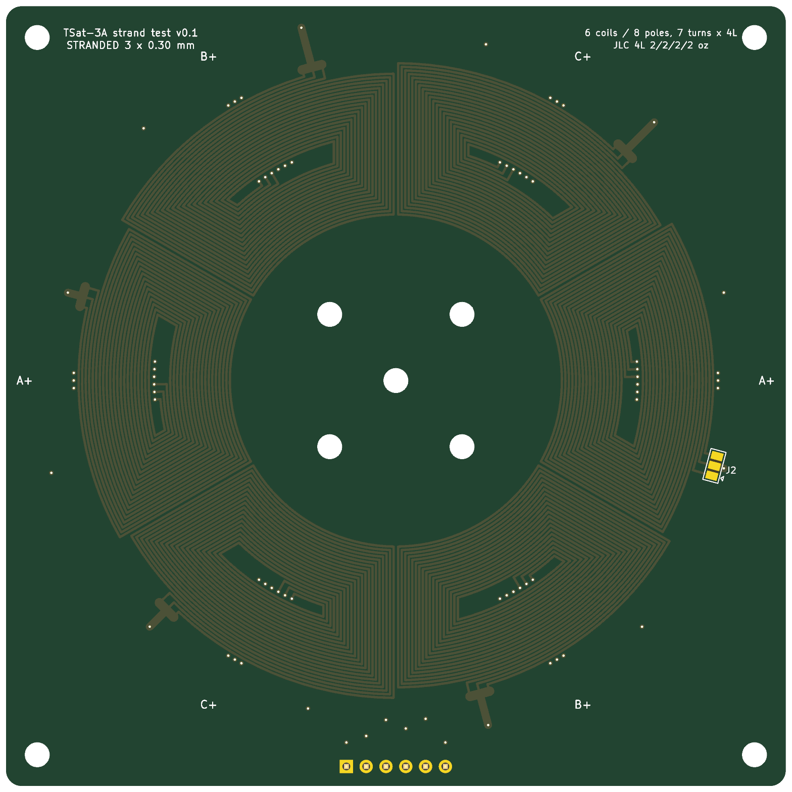

# PCB motor strand test: solid vs stranded stators (v0.1)

Two 4-layer stators that are identical except for the coil copper. One winds a solid 1.2 mm trace.
The other winds the same 1.2 mm as three 0.30 mm strands, transposed at the layer vias ("PCB Litz").
Spinning the same rotor over each board measures how much eddy drag the strands remove. Today that
number only exists in the model (`sim/pcbmotor/ace_stackups.py`, `cubesat_wheels.py`,
`large_wheels.py` all assume stranded windings). This board tests it.



## Why the payload geometry, not the small test stator

Eddy loss goes with trace width squared. On the 40 mm test stator the 0.15 mm traces lose almost
nothing, and even 1 mm traces with its small magnets give about 0.16 mN·m at 3,000 rpm. Bearing
drag would swamp that. These boards are the recommended high-momentum payload stator
(`payload_high_momentum` in `sim/results/pcbmotor_designs.json`) and run the payload rotor. They're
built on JLC's all-2 oz 4-layer board, the best JLC option in `sim/results/pcbmotor_ace_stackups.md`.
The payload design itself is 2 oz outer / 1 oz inner. The solid board loses about 7.3 mN·m at
3,000 rpm, so the difference is easy to measure, and the result checks the payload board directly.

## Files

| File | What it is |
|---|---|
| `StrandTest_solid.kicad_pro` / `.kicad_pcb` | Solid board. Open the `.kicad_pro` in KiCad 10. |
| `StrandTest_stranded.kicad_pro` / `.kicad_pcb` | Stranded board. |
| `gen_strand_test.py` | Generates both boards from the sim's design and `sim/pcbmotor/bundle.py`. |
| `strandtest_<variant>_asbuilt.json` | Turns, lane lengths, ring track lengths, J2 pad-to-strand map. `sim/pcbmotor/strand_test.py` reads them. |
| `renders/` | 3D renders from `kicad-cli`. |

The copper is built in `sim/pcbmotor/bundle.py`, and the solid board is the same code with one
strand. The predictions come from `sim/pcbmotor/strand_test.py` and are written to
`sim/results/pcbmotor_strand_test.md`.

## Regenerate and check

```bash
python3 PCBMotorStrandTest/gen_strand_test.py                     # both boards (system Python, has pcbnew)
kicad-cli pcb drc --severity-error PCBMotorStrandTest/StrandTest_solid.kicad_pcb
kicad-cli pcb drc --severity-error PCBMotorStrandTest/StrandTest_stranded.kicad_pcb
python3 PCBMotorTest/check_spacing.py PCBMotorStrandTest/StrandTest_solid.kicad_pcb --space 0.15
python3 PCBMotorTest/check_spacing.py PCBMotorStrandTest/StrandTest_stranded.kicad_pcb --space 0.15
cd sim && .venv/bin/python tests/test_bundle.py && .venv/bin/python -m pcbmotor.strand_test
```

The generator overwrites both boards. Once you start editing one in the KiCad GUI, either keep
using the script (change its parameters and regenerate) or switch to editing by hand, not both.

## Design

| | |
|---|---|
| Fab | JLCPCB 4-layer, 1.6 mm, 2 oz copper on all four layers (`jlc4_2oz`, set by `STRAND_TEST_STACKUP` in `sim/pcbmotor/bundle.py`). JLC only offers 2 oz inner copper on 4-layer 1.6 mm boards with 2 oz outer. The stackup in the file is JLC's published one: 70 / 61 / 61 / 70 µm copper, 0.436 mm prepreg, 0.5 mm core, 1.63 mm finished. |
| Board | 100 × 100 mm. Four M3 corner holes, an M3 centre hole, and four M3 holes on a 24 mm circle for a bearing housing. |
| Winding | 6 coils / 8 poles, 21–41 mm radius, 1.2 mm bundle / 0.15 mm space, 7 turns per layer, 4 layers in series per coil, two coils in series per phase |
| Solid | one 1.2 mm trace |
| Stranded | three 0.30 mm strands, 0.15 mm apart (JLC's 2 oz minimum) |
| Vias | 0.3 mm drill / 0.6 mm pad, one per strand at each layer change |
| Ring | Phase wiring arcs on In1 and In2 in parallel, 0.9 mm wide, outside the winding at 43.6–46.9 mm radius |
| Header J1 (bottom, 2.54 mm) | 1 B1, 2 A2, 3 C2, 4 B2, 5 A1, 6 C1, the same as the test stator. For star, tie A2 + B2 + C2. |
| Rotor (not drawn) | payload rotor: 8 × 19.05 × 12.7 × 6.35 mm N42 blocks at 31 mm radius on an 84 × 1.5 mm steel disc, 0.6 mm air gap. The F.Fab layer shows the magnets. |

**How the strands are wound.** Each turn is a bundle of three lanes that fills the solid trace's
width, so both boards have the same turns and the same current centroid (Kt 20.1 mN·m/A on both).
The strands only join at the coil terminals. On L1 they start from a short bus arc outside the
winding, and on L4 they end on another.

**Transposition.** With only through vias and radial stubs, the lane next to the coil opening has
to leave a layer first, so every via set reverses the lane order. A strand runs lane s on L1,
n−1−s on L2, s on L3 and n−1−s on L4. Over the four layers every strand links almost the same
flux. Without that, a current would circulate round the strand loop at speed. The model puts the
untransposed version at 0.33 mN·m at 3,000 rpm, nearly doubling the stranded board's drag. With the
transposition it's 0.2 % of the drag.

**Vias.** For the payload geometry the coil opening is a wide, shallow slot, about 1.1 mm of
clear space between the last turns. The L1→L2 and L3→L4 vias sit side by side in a row across it.
The L2→L3 vias sit just outside the winding on the coil axis. On the solid board the 1.2 mm trace
necks down to 0.6 mm for the last stub into each via, so its round end doesn't reach the next turn.

**J2 (stranded board only).** On coil A+ (the right-hand A+), the three strands end on a 3-pad
solder jumper instead of a bus. The phase lead connects to pad 2, the middle strand. For normal
use, **bridge 1-2 and 2-3 with solder**. Left open, it lets you:
- check strand continuity and isolation: pad to pad reads two strands in series, 3.07 Ω;
- measure the strand-to-strand back-EMF directly with the rotor spinning. This is the quantity the
  transposition is meant to cancel.

J2 sits at 42.3 mm radius, outside the magnet corners (41.0 mm), so solder on it can't touch the
rotor.

## Checks done (2026-11-19)

- **KiCad DRC:** 0 errors and 0 unconnected on both boards.
- **`check_spacing.py` at 0.15 mm:** 0 violations on every layer of both boards. All strands of a
  phase are one net, so DRC never checks strand-to-strand gaps; this check does. Rerunning it at
  0.16 mm flags the strand gaps everywhere, which shows it sees them. It found a real problem on the
  first pass: the solid trace's round end reached past its via toward the next turn. That's why the
  via stubs neck down.
- **`sim/tests/test_bundle.py`:** strands are continuous through their vias, at least 0.15 mm apart
  inside the winding, every lane winds counter-clockwise, and every strand gets the same total lane
  offset.

`check_spacing.py` got one change for these boards. Along a single track, it now treats points
closer than the track's own width + space as the same copper. Before, a 1.2 mm trace flagged
itself. The 0.15 mm test stator still checks clean.

## What the boards should measure

From `sim/results/pcbmotor_strand_test.md` (JLC's published stackup, 2026-11-23). Drag is the stator's own, with the phases open. It
doesn't include bearing drag (see below).

| | Solid | Stranded |
|---|---|---|
| Phase resistance, 20 °C (A1–A2 / B1–B2 / C1–C2) | 0.82 / 0.84 / 0.83 Ω | 1.07 / 1.09 / 1.07 Ω |
| Kt (FOC, per A peak) | 20.1 mN·m/A | 20.1 mN·m/A |
| Phase back-EMF | 1.40 V peak per 1000 rpm (66.7 Hz electrical per 1000 rpm) | same |
| Stator drag at 1,000 / 2,000 / 3,000 rpm | 2.43 / 4.85 / 7.28 mN·m | 0.114 / 0.227 / 0.341 mN·m |
| Loss at 3,000 rpm | 2.29 W | 0.107 W |
| Extra deceleration at 3,000 rpm (rotor J = 2.04e-4 kg·m²) | 341 rpm/s | 16.0 rpm/s |

Drag ratio solid / stranded: **21×**. This matches the design-study estimate (21×), so a measured
ratio well below that means the strand model is missing something.

**J2 open** (stranded board): DC resistance pad to pad is 3.07 Ω, and phase A reads 2.11 Ω
instead of 1.07 Ω. With the rotor spinning, the open-circuit voltage between pads is 2.1–4.6 mV rms
per 1000 rpm, about 6–14 mV rms at 3,000 rpm. An untransposed bundle would show 36–74 mV rms per
1000 rpm. Measure it with a scope on AC coupling, triggered on a phase.

## Test procedure

1. **Baseline.** Spin the rotor on its bearing with no stator (an air-core stator puts no axial load
   on the bearing, so this is the same bearing load). Log the coast-down. That gives bearing + air
   drag against speed.
2. **Each board.** Spin the rotor up with the board itself as the motor, using any 3-phase FOC driver
   (for example SimpleFOC with an AS5048 on the axle). Then **disconnect the phases** and log the
   coast-down from the back-EMF: frequency gives speed, and a scope or ADC on A1–B1 is enough.
   Don't leave a powered-down driver connected: its MOSFET body diodes rectify the back-EMF and brake
   the rotor. A driver left powered with its bus above the back-EMF (7.3 V line peak at 3,000 rpm) is fine.
3. **Reduce.** Stator drag at speed ω is J × (deceleration with the board − deceleration without). Get
   J from the rotor's measured mass and dimensions, or from a spin-up at known current (J = Kt·I / α).
   The solid/stranded ratio doesn't depend on J.
4. **Also measure** phase R cold (4-wire, log the temperature: copper rises 0.39 %/K) and back-EMF
   amplitude. On the stranded board, measure the J2 pads before bridging.

The solid board's eddy loss is 2.6 W at 3,000 rpm. That's fine for a coast-down, but don't hold it
at speed for long.

## Ordering

Order both designs at JLCPCB: 4 layers, 1.6 mm, outer copper 2 oz, inner copper 2 oz, any colour.
Upload the Gerbers and drill files (`kicad-cli pcb export gerbers` / `kicad-cli pcb export drill`),
which aren't generated yet. Both boards fit in 100 × 100 mm. Get a quote: per the 2026-11-18 notes,
JLC pre-collects a 35 % DDP on PCBs for US individuals. OSH Park can't do 2 oz copper; its 4-layer
board (1.24 oz outer, 0.5 oz inner) would still compare solid against stranded, at about
$155 per design for three.

## Still open

- **Rotor and rig.** Nothing is drawn: the payload rotor disc and magnet carrier, the bearing housing
  on the four hub holes, and shims to set the 0.6 mm gap. Eight 19 mm N42 blocks on a steel disc pull
  hard: assemble with a jig.
- **Fab files.** Gerbers and drill files aren't exported yet.
- **JLC stackup.** Since 2026-11-23 the model and the board file use JLC's published all-2 oz stackup
  (70 µm outer, 61 µm inner copper, 0.436 mm prepreg, 0.5 mm core). Check that the order form's
  stackup matches.
