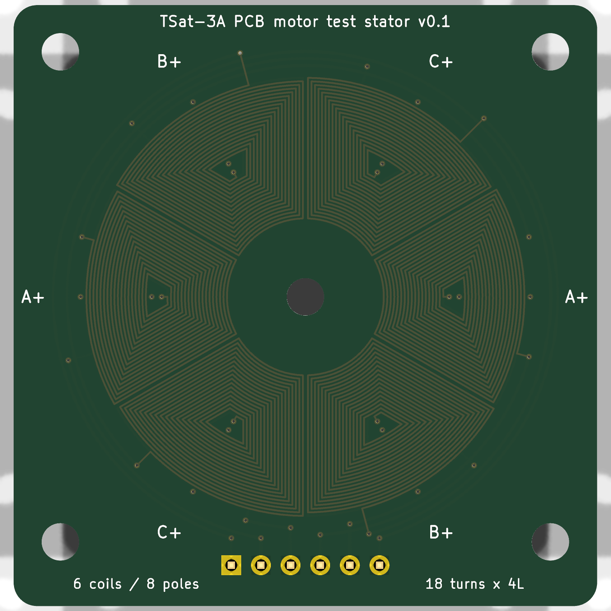

# PCB motor test stator (v0.1)

A small 4-layer stator for checking the PCB motor model in `sim/` on the bench before
the payload board is designed. It is the "test" design from `sim/results/pcbmotor_designs.json`
(`test_4L_6c8p_w0.15_m8.0x3.0`), laid out as real spiral coils.



## Files

| File | What it is |
|---|---|
| `PCBMotorTest.kicad_pcb` / `.kicad_pro` | The board. Open the `.kicad_pro` in KiCad 10. No schematic: the board is generated, and the only parts are the header and holes. |
| `gen_stator.py` | Generates the board from the sim's design and `sim/pcbmotor/layout.py`. |
| `check_spacing.py` | Copper spacing check that ignores nets (see "Checks"). |
| `stator_asbuilt.json` | Turn counts and ring-track lengths written by the generator. The sim uses them for its as-built model. |
| `renders/` | 3D renders from `kicad-cli`. |

## Regenerate and check

```bash
python3 PCBMotorTest/gen_stator.py                       # system Python (has KiCad's pcbnew)
kicad-cli pcb drc --severity-error PCBMotorTest/PCBMotorTest.kicad_pcb
python3 PCBMotorTest/check_spacing.py                    # turn-to-turn gaps, all layers
cd sim && .venv/bin/python -m pcbmotor.asbuilt          # model of the board as laid out
```

The generator overwrites the board. Once you start editing in the KiCad GUI, either keep using the
script (change its parameters and regenerate) or switch to editing by hand, not both.

## Design

| | |
|---|---|
| Fab | JLCPCB 4-layer, JLC04161H-3313 (published stackup): 1 oz (35 µm) outer, 0.5 oz (15.2 µm) inner copper, 0.206 mm 3313 prepreg, 1.065 mm core, 1.58 mm finished. Ordered 2026-11-23 (5 boards, $35.06 after promotions, with UPS Express Saver and the 35% US duty). Designed on OSH Park's stackup (1.7 mil plated outer copper); the board still meets OSH Park's rules. |
| Board | 50 × 51.5 mm, four M3 holes on a 42 mm square, M3 centre hole for a fixed axle |
| Winding | 6 coils / 8 poles, 13–38 mm diameter, 0.15 mm trace / 0.15 mm space |
| Vias | 0.3 mm drill, 0.508 mm pad (0.254 mm until 2026-11-23: JLC charges extra below 0.3 mm) |
| Coil | 4 layers in series, 17.0–17.6 turns per layer (18 turn rings) |
| Phases | Two coils per phase in series. Both ends of each phase go to the header. Star or delta is wired off the board. |
| Header J1 (bottom side, 2.54 mm) | 1 B1, 2 A2, 3 C2, 4 B2, 5 A1, 6 C1. For star, tie A2 + B2 + C2 together and drive A1 / B1 / C1. |

**Coil copper.** Each layer is one spiral. L1 spirals in, L2 out, L3 in, L4 out, with the current going
the same way round on every layer. Through vias join them: two in the coil centre (L1→L2 and L3→L4) and one
just outside the winding (L2→L3). OSH Park has no blind vias, so the two centre vias need room side by
side. That is why the coil has 18 turn rings instead of the 20 in the design sweep. The turn edges are
parallel to the sector boundary, so every gap is exactly 0.15 mm.

**Ring.** The coils are joined into phases by arcs on In2.Cu between 19.8 and 21.6 mm radius. Short leads on
F.Cu / B.Cu run out to them. The rotor (40 mm) covers the ring, which is fine: nothing on top sticks up.
The header is on the bottom so its plastic stays away from the rotor.

## Checks done (2026-11-18)

Rerun on 2026-11-23 after the via drill went to 0.3 mm: DRC 0 violations, `check_spacing.py` 0 violations.

- **KiCad DRC:** 0 errors, 0 unconnected. The only warnings say the footprint libraries aren't in
  KiCad 10's library table yet; they go away once KiCad 10 has been opened in the GUI once.
- **`check_spacing.py`:** 0 violations at 0.15 mm on all four layers. This matters because a whole phase is
  one net, so KiCad never checks the gap between turns of the same coil. To prove the check works,
  rerunning it with a 0.16 mm rule flags every turn.
- **`sim/tests/test_layout.py`:** every layer path is continuous, ends on the right via, and goes round the
  same way.

## What the board should measure

From `sim/results/pcbmotor_test_asbuilt.json`: the EM model run on this exact copper, with the design's
rotor (8 × 8 × 3 mm N42 discs at 12.75 mm radius, 1.5 mm steel back plate, 0.5 mm gap).

| Quantity | Predicted | Design sweep |
|---|---|---|
| Phase resistance (A1–A2 etc.), 20 °C | 23.0–23.3 Ω (B is longest) | 19.3 Ω (OSH Park copper) |
| Phase back-EMF | 0.79 V peak per 1000 rpm (66.7 Hz electrical per 1000 rpm) | 0.73 |
| Line-to-line back-EMF, star | 1.37 V peak per 1000 rpm | |
| Kt (sinusoidal drive, per A peak) | 11.3 mN·m/A | 10.5 |
| Km | 1.92 mN·m/√W | 1.95 |
| Voltage-limited stall at 11.1 V | 3.1 mN·m | 3.5 |

Kt is 8% above the sweep: the as-built turns are wider at the outer radius, and that outweighs the two
dropped turns. The resistance is 17% above the OSH Park figure (19.6–19.8 Ω) because JLC's finished copper
is thinner (35 µm outer against OSH Park's 43 µm plated, 15.2 µm inner against 17.5 µm). The deeper
bottom layers cost about 1% of Kt, so Km is 9% below the OSH Park build. Copper resistance rises 0.39 %/K, so measure R cold or log board temperature.

**Back-EMF against air gap, with and without the steel back plate** (V peak per 1000 rpm, phase):

| Gap | 0.5 mm | 0.75 mm | 1.0 mm | 1.5 mm |
|---|---|---|---|---|
| With 1.5 mm steel plate | 0.79 | 0.72 | 0.65 | 0.53 |
| Magnets only | 0.61 | 0.55 | 0.49 | 0.41 |

The CMU comparison did not test the back-iron part of the model. Spinning the same rotor with and without
its plate tests it directly: the model predicts a ratio of about 1.31 at 0.5 mm.

## Still open

- **Rotor and rig.** The design assumes a 40 mm steel disc carrying the 8 magnets with alternating poles, on a bearing
  around an M3 axle through the centre hole, with shims to set the 0.5 mm gap. Nothing is drawn yet. For
  sensored FOC down to zero speed, an AS5600/AS5048 magnetic encoder on the axle end works; there are no Hall
  sensors on this board.
- **Fab files** aren't committed. They were made with `kicad-cli pcb export gerbers` (copper, mask, silk,
  paste, Edge.Cuts) and `kicad-cli pcb export drill`, then zipped. OSH Park runs KiCad 9, so send it gerbers,
  not the KiCad 10 `.kicad_pcb`.
