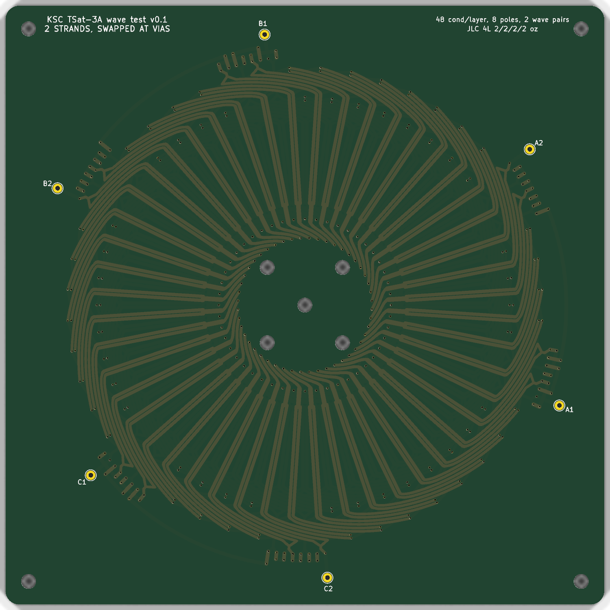

# PCB motor wave-winding test stators (v0.1)

Three 4-layer stators that test the wave winding the sim now recommends for the payload. They are
`sim/results/pcbmotor_wave.md` and RESULTS.md 5f, built for the same rotor as the strand-test boards.
The three boards differ only in their copper:

| Board | Winding | What it measures |
|---|---|---|
| `WaveTest_solid` | one trace per conductor, width ≤ 1.2 mm | baseline Kt, R and eddy drag of the wave winding |
| `WaveTest_swap` | two strands per conductor (≤ 1.6 mm in all), lanes **swapped** at every outer via | the recommended winding: lower eddy drag, no strand circulating current |
| `WaveTest_fixed` | the same two strands, lanes **fixed** | the circulating current that the swap cancels |

`swap` and `fixed` have identical copper apart from where the strands cross at the outer vias. Their
difference in coast-down drag is the strand circulating current, which every paper in `~/KSC/research`
flags as the failure mode of paralleled PCB traces.



## Files

| File | What it is |
|---|---|
| `WaveTest_<variant>.kicad_pro` / `.kicad_pcb` | The boards. Open the `.kicad_pro` in KiCad 10. |
| `gen_wave_test.py` | Draws the boards from `sim/pcbmotor/wave_layout.py` (system Python, has `pcbnew`). |
| `wavetest_<variant>_asbuilt.json` | Layout summary: radii, jumpers, the loop chain of each phase, and the sim's checks. |
| `renders/` | 3D renders from `kicad-cli`. |

The copper is built in `sim/pcbmotor/wave_layout.py`, which also checks it. `sim/pcbmotor/wave_asbuilt.py`
runs the EM model on exactly that copper and writes `sim/results/pcbmotor_wave_asbuilt.json`.

## Regenerate and check

```bash
python3 PCBMotorWaveTest/gen_wave_test.py                 # all three boards (system Python, has pcbnew)
for v in solid swap fixed; do
  kicad-cli pcb drc --severity-error PCBMotorWaveTest/WaveTest_$v.kicad_pcb
  python3 PCBMotorTest/check_spacing.py PCBMotorWaveTest/WaveTest_$v.kicad_pcb --space 0.15
done
cd sim && .venv/bin/python tests/test_wave_layout.py && .venv/bin/python -m pcbmotor.wave_asbuilt
```

The generator refuses to write a board unless the sim's checks pass:
- each phase is one series path through all 64 of its conductors, with the current outward on every
  + conductor;
- no shorts between phases;
- every copper gap is at least 0.15 mm.

As generated (2026-11-19), all three boards have 0 DRC errors, 0 unconnected items, and 0 net-blind
spacing violations at 0.15 mm on every layer. `check_spacing.py` was extended for these boards: it now
joins tracks that meet end to end into one piece of copper, so a curve drawn as short segments isn't
mistaken for overlapping copper. It also gained `--dump file.csv`. `PCBMotorTest` and both
`PCBMotorStrandTest` boards still pass it.

The generator overwrites the boards. Once you edit one in the KiCad GUI, either keep using the script
(change `wave_layout.py` and regenerate) or switch to editing by hand, not both.

## Design

| | |
|---|---|
| Fab | JLCPCB 4-layer, 1.6 mm, 2 oz copper on all four layers (`jlc4_2oz`, the same as the strand-test boards). Dielectric thicknesses are the sim's assumed ones (JLC doesn't publish them). |
| Board | About 129 × 129 mm. M3 centre hole, four M3 hub holes on a 23 mm circle, four M3 corner holes. |
| Winding | 48 conductor positions per layer, 8 poles, q = 2 conductors per pole per phase, full pitch. Two layer pairs, each a two-layer wave: L1 + L2 and L3 + L4. All 4 layers are in series, 64 conductors per phase. |
| Radial (active) sections | pair 1: r 17.3 to 46.4 mm; pair 2: r 22 to 40 mm. The magnets cover 21.5 to 40.5 mm. |
| Via rings | pair 1: r 14.5 and 51.0 mm; pair 2: r 18.6 and 44.6 mm. 0.3 mm drill, 0.56 mm pad. |
| Strands | Two lanes from the start of the active section (r 22 mm) to the outer via. They merge into one solid trace at the inner end. |
| Phase pads | Six THT wire pads, A1/A2, B1/B2, C1/C2, at r about 59 mm. Each phase is the winding between its two pads. Wire star or delta off the board. |
| Rotor (not drawn) | The payload rotor: 8 × 19.05 × 12.7 × 6.35 mm N42 blocks at r 31 mm on an 84 × 1.5 mm steel disc, 0.6 mm air gap. The magnets are on F.Fab. |

**Layout.** Each conductor runs radially across the magnets, then slants half a pole pitch to a via
ring at each end. A top conductor (L1 or L3) and the bottom conductor a pole pitch further round (L2 or
L4) share an outer via. That bottom conductor and the next top conductor share an inner via, and so on
round the board. That is a full-pitch wave, with nothing crossing on any layer.

**Why the two pairs are nested.** Through vias pierce all four layers, and a pair's slanted end turns
are packed too tightly to let the other pair's via through. So pair 2's vias sit on rings at 18.6 and
44.6 mm. Pair 1 runs straight past them, exactly midway between them (it sits half a slot round from
pair 2), and only then slants to its own rings at 14.5 and 51.0 mm.

**The strand swap is just via placement.** At an outer via, the top conductor's lanes and the bottom
conductor's lanes meet where they cross.
- `swap` pairs each lane with the opposite lane. The two crossings stack radially at the via's angle,
  so each strand spends one conductor on each side.
- `fixed` pairs each lane with the same lane. The crossings sit side by side on the ring.

The strands merge at the inner end, so each top + bottom conductor pair is one strand loop. With the
swap, each strand in that loop links the same flux to first order.

**Loops, breaks and jumpers.** With every via in place, each phase forms 8 closed wave loops:
2 pairs × 2 slots × 2 pole parities. Each loop is opened at one outer via near its phase's cluster
(A at ~10°, B at ~130°, C at ~250°).
- At each break the lanes fan out to a root 1.2 mm beyond the ring. A stub runs on to a terminal via
  at r ≈ 53.8 mm.
- Jumpers chain the loops in series. Each is a radial lead on F.Cu and an arc on In1.Cu and In2.Cu in
  parallel, on rings at 55.3 and 56.5 mm.
- The first and last loop ends run out on B.Cu to the phase pads.

## Predictions (as built, `sim/pcbmotor/wave_asbuilt.py`)

| | Kt mN·m/A | R phase Ω | Km mN·m/√W | Eddy drag @2000 rpm | Strand circulating @2000 rpm | Total drag @2000 rpm |
|---|---|---|---|---|---|---|
| solid | 22.4 | 0.89 | 19.4 | 0.36 W | – | **1.70 mN·m** |
| swap | 22.4 | 0.86 | 19.7 | 0.16 W | 0.001 W | **0.76 mN·m** |
| fixed | 22.4 | 0.86 | 19.7 | 0.16 W | 0.19 W | **1.67 mN·m** |

Drag grows linearly with speed: at 3000 rpm it is 2.5, 1.1 and 2.5 mN·m.

- **swap vs solid:** stranding halves the eddy drag.
- **fixed vs swap:** the about 0.9 mN·m difference is the circulating current alone.

Phase resistance includes about 0.1 Ω of jumpers, stubs and vias. Plan on a 5–15% torque derating
before trusting Kt to better than that: Paul et al. 2019 measured a wave PCB motor 15.5% below FEA.

## Bench tests (same rig and rotor as the strand-test boards)

1. DC resistance of each phase, cold, with board temperature logged. Compare with R above.
2. Back-EMF at a known speed (spin the rotor with a drill or the strand-test rig). Peak phase EMF per
   rad/s = 2/3 × Kt.
3. Coast-down from about 3000 rpm with the phase pads open: measure the drag torque for each board, then
   for a plain FR-4 blank to separate the bearing and windage drag. Expect solid ≈ fixed > swap.
4. Optional: static torque at 1 A with the rotor locked (Kt directly).

## Open items

- **Rotor and rig.** These need the same rotor and spin rig as the strand-test boards. That is Murilo's
  rotor review task in Notion.
- **Board size.** The nested via rings push pair 1's outer vias to r = 51 mm, and the jumpers and pads
  out to about 59 mm, so this board is about 129 mm square. **This layout does not fit the 90 × 90 mm
  payload.** Options for the payload:
  - blind or buried vias, if JLC offers them on 4 or 6 layers at a sensible price (not checked);
  - solid traces only (no strands, so the via ends can be steeper and shorter);
  - a smaller active band, at some cost in Kt;
  - a 6-layer board with the jumpers on their own layers.
- **Break conductors.** The 8 conductor pairs per phase that hold a loop break merge their strands
  without a swap. The model treats them like the rest, which slightly underestimates `swap`'s
  circulating current.
- **JLC confirmation.** Check that a 0.3 mm drill with a 0.56 mm via pad (0.13 mm annular ring) is
  accepted on 2 oz copper. The strand-test boards use 0.6 mm pads.
