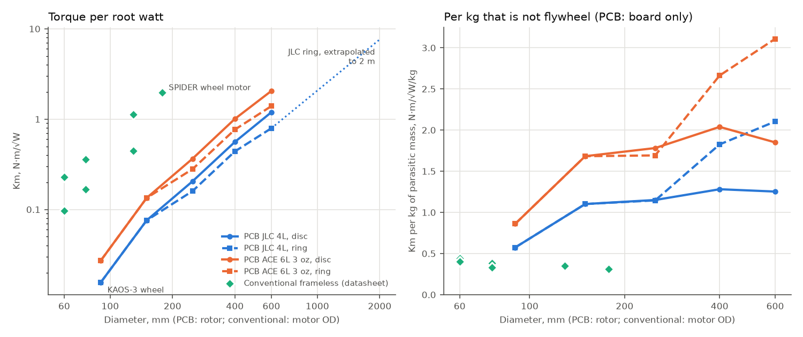

# TSat-3A reaction wheel: simulation results

Generated 2026-11-17 by the scripts in `sim/` (see [`../README.md`](../README.md) for models and
assumptions). Full Monte Carlo tables: [`yaw_tables.md`](yaw_tables.md). Raw data:
`pcbmotor_sweep.csv`, `pcbmotor_designs.json`, `yaw_summary.csv`, `yaw_requirements.json`,
`tsat1_swing.json`, `video_spin_tsat2b_full.*`, `video_phases_tsat2b_full.*`, `yaw_calibration.json`,
`hang_summary.json`. Sections 5 and 6 (PCB motor design studies, KAOS-3 hanging payload) were added
2026-11-18/19, 5e–5h on 2026-11-19, and 5i and 5k on 2026-11-20. All eddy, drag and loss figures
were rerun on 2026-11-20 after a fix to the eddy model (section 7, PCB motor model). On 2026-11-23 the
all-2 oz JLC stackup (`jlc4_2oz`) was switched from an assumed build to JLC's published one (61 µm inner
copper, 0.5 mm core) and every study using it was rerun: Km fell 2–3% and eddy drag about 10%; no verdict
changed. The test stator's numbers now use JLC04161H-3313, the stackup it was ordered on. Short summaries of each study are on the
club Notion under TSat-3A Home → Design Studies & Simulations; this file and the per-study files
hold the full data.

## Conclusions

Points 1–6 were written 2026-11-17/19 after calibrating the disturbance model to the TSat-2B onboard
flight video (section 2b). The video showed far more spin than the original "medium" assumption, so
the requirements and the recommended payload design changed. Points 7–10 were added 2026-11-20 from
the winding and stator studies (5f–5i); they change the recommended winding in point 2. Point 7 was
revised the same day after section 5k gave the spiral the same envelope as the wave, and again when
5k added a stranded spiral.

1. **Put a swivel or slip ring at the payload attachment.** TSat-2B, flown without one, spun at
   172 °/s RMS (median 15 rpm, 1 s peaks up to 128 rpm) and the camera was steady (under 2 °/s) only
   1.5% of the time. With the disturbance calibrated to that flight, every candidate (and even an ideal
   actuator) fails without a swivel: holding heading against the line would take 80–340 mN·m of torque
   and far more stored momentum than any wheel has.
2. **A PCB motor can be the main reaction-wheel motor, but it needs more stored momentum than the
   first payload design.**
   - Recommended: the high-momentum payload variant (JLCPCB 4-layer, 2 oz outer / 1 oz inner, 6 coils /
     8 poles, 19.05 × 12.7 × 6.35 mm magnets, 84 mm × 3 mm steel disc). It stores 90 mN·m·s and held
     the camera steady 99–100% of the time behind a swivel or slip ring in the line-driven case,
     and 77–83% in the gust-driven worst case. It was the best real candidate in every case.
   - The first payload design (12 coils / 16 poles, 1.5 mm disc, 37 mN·m·s) reaches 96–99% median but
     saturates in 2–4 of 8 runs. It is the lighter fallback (117 g against 223 g rotating).
   - The 40 mm test stator is too small to fly. It exists to check the model on the bench.
   - The motor model reproduces the one measured PCB reaction wheel we could check (CMU, SmallSat
     2024) within about 10% on torque constant and 11% on resistance (section 1).
3. **Momentum and control bandwidth are the hard requirements, not raw torque.**
   - With a swivel: at least 6 mN·m peak torque and 60 mN·m·s of usable momentum each way
     (line-driven case); 15 mN·m and about 130 mN·m·s if the spin is mostly aerodynamic (gust-driven).
   - The attitude loop must run at 100 Hz with about 20 rad/s bandwidth. At 50 Hz the loop goes
     unstable above about 15 rad/s, and an 8 rad/s loop leaves the camera unsteady about a quarter of
     the time even with a perfect actuator.
   - Smooth sensored control through zero speed. The sensorless Maxon EC32 flat failed in every case.
4. **Use the cheap fab for the payload board.** JLCPCB's 1 oz inner layers, against OSH Park's 0.5 oz,
   cut resistance enough to raise torque per √watt (Km²) by 50–67% over OSH Park for the same copper
   pattern.
5. **Keep the 1U body aerodynamically symmetric about the yaw axis.** If TSat-2B's spin was mostly
   wind torque rather than line twist, a swivel helps less and the momentum demand doubles; a centred
   tether attachment and no one-sided protrusions reduce that torque at the source.
6. **KAOS-3 (three-axis, eye just above the centre of mass) works in simulation with a 2 A driver**
   (section 6): it holds within 0.7° through a ±10° swing and passes the D&C demo specs S1–S3 at eye
   heights of 2–6 mm. Pitch/roll momentum is set by the centre-of-mass error at release (about 100
   mN·m·s per mm), so pre-trim before release or size the wheels for about 70 mN·m·s.
7. **Use stranded spiral coils with their end turns outside the magnets** (section 5k). Same rotor,
   board and drive as point 2: JLC 4-layer 2 oz on every layer, winding r 15–41.8 mm, 13 turns per
   layer of a 0.75 mm bundle of 2 strands (0.30 mm, 0.15 mm apart) that swap lanes at every via, the
   two coils of each phase in parallel.
   - As modelled (JLC's published all-2 oz stackup): Km 21.1, loss 0.56 W at 15 mN·m and 2000 rpm,
     no-load 4070 rpm (H 87 mN·m·s).
   - Eddy drag is 0.24 mN·m at 2000 rpm, 3.9% of the 6 mN·m control margin. The solid 0.8 mm spiral
     takes 2.1 mN·m (36%) and the stranded wave 0.76 mN·m (13%).
   - Against the solid 0.8 mm spiral: 10% less Km, but 9× less eddy, so it loses less power above
     about 1000 rpm at 15 mN·m, and at every torque the 1 A drive can give at 2000 rpm.
   - Against the wave: Km 21.1 against 20.6 (blind vias) and 19.2 (through vias), loss 0.56 against
     0.69 and 0.77 W. It fits the 90 mm payload board with through vias, a 3-track wiring ring and
     no jumpers. The wave boards are 117–129 mm.
   - PWM ripple loss is 0.15 W at 50 kHz against the wave's 1.05 W, because Ls is 18.8 µH against 8.1.
   - The solid 0.8 mm spiral (Km 23.7, 0.85 W) is the fallback if the strand-test board shows the
     strands don't behave as modelled; the wave is no longer needed as one.
   - 5f's "wave wins" came from a spiral kept inside r 21–41, with its end turns over the magnets.
   - Plan on a 5–15% torque derating until a board is measured.
8. **Drive at 11.1 V (3S) with PWM at 100 kHz or more** (section 5h). Turn count doesn't change Km,
   so the bus voltage only sets the rewind (n must be a multiple of 24). The phase inductance is only
   8.1 µH, so at 50 kHz the PWM ripple costs about 1 W per wheel at 2000 rpm, more than the copper
   loss. 100 kHz cuts it to about 0.26 W; series inductors also work. That applies to the wave. The
   stranded ends-out spiral in point 7 has 2.4× the inductance and loses only 0.14 W at 50 kHz
   (section 5k).
9. **One stator board, one rotor, no stator iron** (sections 1, 5g, 5i). Stacked boards, dual rotors,
   a slotless stator yoke and a dual stator all lose at the payload's operating point (speed, eddy drag,
   axial pull or mass). The cheap gain is thicker magnets: two stacked blocks per pole on the existing
   3 mm of steel give Km +14% and 43% more inertia for 92 g.
10. **PCB motors win for large, slow wheels** (section 5e). Km grows as D² (disc) or D^1.84 (ring),
    so a PCB motor reaches iron-core frameless motors at about 400–600 mm and leads per kilogram of
    non-flywheel mass from about 150 mm. At 90 mm its Km is 3–6× lower than a frameless motor's, which
    is acceptable only because the wheels need mN·m and a fraction of a watt.

## 1. PCB motor designs

### Designs from the first sweep

These are the 2026-11-17 sweep picks. The current recommendation is the high-momentum 6c/8p variant
(Conclusions point 2) with a wave winding (point 7, section 5f); the 12c/16p payload stator below is
the lighter fallback.

| | Test stator | Payload stator (12c/16p, first pick) | Payload, OSH Park 6L (comparison) |
|---|---|---|---|
| Name | `test_4L_6c8p_w0.15_m8.0x3.0` | `payload_jlc4_2oz_out_12c16p_w1.2_h3.18` | `payload_osh6_9c12p_w1.2_h3.18` |
| Fab / stackup | OSH Park 4-layer (published stackup: 1.7 mil plated outer, 0.5 oz inner, 39 mil core) | JLCPCB 4-layer, 2 oz outer / 1 oz inner | OSH Park 6-layer |
| Board | 42 mm round | 90 × 90 mm, winding 42–82 mm diameter | same as payload |
| Coils / poles | 6 / 8 | 12 / 16 | 9 / 12 |
| Trace / space | 0.15 / 0.15 mm, 20 turns per layer per coil | 1.2 / 0.15 mm, 5 turns per layer per coil | 1.2 / 0.15 mm, 7 turns |
| Magnets | 8 × (8 mm dia × 3 mm) N42 discs | 16 × (19.05 × 6.35 × 3.18 mm) N42 blocks | 12 × (19.05 × 9.53 × 3.18 mm) |
| Rotor | 1.5 mm steel back plate, 40 mm | 84 mm × 1.5 mm steel disc (back iron and flywheel) | same as payload |
| Air gap | 0.5 mm | 0.6 mm | 0.6 mm |
| Kt (per A peak, FOC) | 10.5 mN·m/A | 26.7 mN·m/A | 38.5 mN·m/A |
| Phase R / L | 19.3 Ω / 169 µH | 1.14 Ω / 95 µH | 3.99 Ω / 228 µH |
| Km (torque per √W) | 1.95 mN·m/√W | **20.4 mN·m/√W** | 15.7 mN·m/√W |
| Torque at 11.1 V | 3.5 mN·m peak (0.33 A, voltage-limited); **2.06 mN·m continuous** (0.20 A, 1.1 W, 40 K rise) | 26.7 mN·m at the 1 A driver limit, 1.7 W, 11 K rise | 38.5 mN·m at 1 A, 6.0 W, 37 K rise |
| No-load speed at 11.1 V | 8,700 rpm (capped at 6,000 for a hand-balanced rotor) | 3,440 rpm | 2,380 rpm |
| Rotor inertia / mass | 4.4×10⁻⁶ kg·m² / 24 g | 1.02×10⁻⁴ kg·m² / 111 g (+5.6 g copper on the board) | 1.07×10⁻⁴ / 117 g |
| Momentum at max speed | 2.8 mN·m·s | **36.7 mN·m·s** | 26.8 mN·m·s |
| Torque ripple (ideal sinusoidal drive) | 0.7% | 2.4% | 1.6% |
| PWM ripple current p-p at 20 / 50 / 100 kHz | 0.41 / 0.16 / 0.08 A | 0.73 / 0.29 / 0.15 A | 0.31 / 0.12 / 0.06 A |

Notes on the choices:
- **Trace width barely changes Km.** It trades torque per amp against speed: fewer, wider turns mean
  more speed and less Kt at the same copper loss.
- **The payload pick maximizes stored momentum** among cheap-fab designs within 10% of the best Km,
  because torque is never the limit (section 4). The highest-Km cheap option is JLC 6-layer 1 oz
  12/16 (21.5 mN·m/√W), but it reaches only 2,310 rpm (24.7 mN·m·s). The JLC 4-layer board with 2 oz
  outer copper stores 49% more momentum for 5% less Km and fewer layers.
- **Test stator.** Run it with ≥100 kHz PWM or a 5 V bench supply: at 50 kHz and 11.1 V the ripple
  (0.16 A) is comparable to its 0.20 A continuous current. Its 40 K continuous limit with natural
  convection is only 1.1 W, so log board temperature during tests.
- **Payload stator.** 50 kHz PWM is enough. Electrical time constant is 84 µs.

Plots: `pcbmotor_test_layout.png`, `pcbmotor_test_waveforms.png`, `pcbmotor_payload_layout.png`,
`pcbmotor_payload_waveforms.png`, `pcbmotor_payload_osh6_*.png`.

### OSH Park vs JLCPCB at the same copper pattern

12 coils / 16 poles, 1.2 mm traces, 3.18 mm magnets, 42–82 mm winding. Km² is torque² per watt of
copper loss.

| Stackup | Copper (outer/inner) | Kt [mN·m/A] | R phase [Ω] | Km [mN·m/√W] | Km² vs OSH Park 6L | Km² vs OSH Park 4L |
|---|---|---|---|---|---|---|
| OSH Park 4L | 1.24 (plated) / 0.5 oz | 27.1 | 2.11 | 15.2 | 0.83× | 1.00× |
| OSH Park 6L | 1 / 0.5 oz (assumed) | 39.7 | 3.78 | 16.7 | 1.00× | 1.20× |
| JLCPCB 4L | 1 / 1 oz | 26.7 | 1.51 | 17.7 | 1.13× | **1.36×** |
| JLCPCB 6L | 1 / 1 oz | 39.7 | 2.27 | 21.5 | **1.67×** | 2.01× |
| JLCPCB 4L | 2 / 1 oz | 26.7 | 1.14 | 20.4 | **1.50×** | 1.81× |

JLCPCB 4-layer with 1 oz inner copper has 28% less phase resistance than OSH Park 4-layer (1.51 against
2.11 Ω) and 36% more Km² for the same copper pattern, even though OSH Park's plated outer copper is
thicker (1.7 mil, from OSH Park's published stackup, checked 2026-11-18). Kt differs by 1.5% between them
because OSH Park's 39 mil core puts its bottom layers closer to the magnets than the assumed JLC
spacing. The OSH Park 6-layer row still assumes bare 1 oz outer copper and even layer spacing. The JLC 1 oz and 2 oz out / 1 oz in spacing is assumed; JLC's stackup tables give the all-2 oz and
JLC04161H-3313 builds, which use the published values since 2026-11-23. Spacing mostly affects Kt, not
the resistance gain.

### Sanity checks against real hardware

| | Km [mN·m/√W] | Stall torque | Speed | Mass |
|---|---|---|---|---|
| Faulhaber 2610T012B (datasheet) | 3.3 | 7.45 mN·m at 12 V | 6,400 rpm no-load | 20 g motor |
| Maxon EC32 flat 226006 (datasheet) | 13.2 | 85 mN·m at 24 V | 4,530 rpm at 24 V | 57 g motor |
| CMU PCB reaction wheel (measured, see below) | 7.1 | 8 mN·m (extrapolated; data to 6 mN·m) | 1,600 rpm at 8 V | 140 g, 9 mm thick, 1U |
| This model, 40 mm test stator | 1.95 | 3.5 mN·m (2.06 continuous) | 8,700 rpm no-load | 24 g rotor |
| This model, 1U payload stator (12 coils) | 20.4 | 26.7 mN·m at 1 A | 3,440 rpm | 111 g rotor + board |
| This model, high-momentum payload stator | 16.1 | 21.7 mN·m at 1 A | 4,220 rpm | 223 g rotor + board |

### Model validation against a built PCB motor (CMU wheel)

`validation/cmu_wheel.py` rebuilds the CMU PCB reaction wheel (Tayal, Fisch, Manchester, SmallSat 2024,
doi:10.26077/sr9e-tc61) from its paper and open design files (github.com/SaralTayal123/PCB_Motors:
coil generator notebook, KiCad board, firmware) and runs the same magpylib Lorentz-force method.

- **Their design:** 36 slots and 12 poles (firmware `PP = 6`; the paper's table says "12 pole-pair",
  but the firmware and README say 12 poles). Two PCB stators, one on each side of the rotor, in
  series. Wave winding, 10 turns, each radial conductor stitched across all 4 layers (1 oz, 1.2 mm
  board), coil diameter 53–79 mm, 0.29 mm traces. 12 × (12.7 × 6.35 × 3.18 mm) N42 magnets on a
  3 mm aluminium rotor, so no back iron. PTFE bushings, Hall sensors, ESP32-S3 + TMC6200 + SimpleFOC.
- **Measured:** phase resistance 5.5 Ω. Torque constant from their Fig. 11: for a constant-voltage
  drive the speed–torque slope is 1.5 R / Kt², independent of supply voltage. The best-fit line
  falls from 171 rad/s at 0 mN·m to 13 rad/s at 8 mN·m, giving **Kt ≈ 20.4 mN·m/A and Km ≈ 7.1
  mN·m/√W** (values read by eye from the figure). Their 8 mN·m stall is an extrapolation; measured
  data reach about 6 mN·m.
- **Model:** phase resistance 6.1 Ω (+11%). Kt depends on the air gap, which the paper doesn't give:

| Air gap (magnet face to copper) | 0.3 mm | 0.5 mm | 0.75 mm | 1.0 mm | 1.5 mm |
|---|---|---|---|---|---|
| Model Kt [mN·m/A] | 28.1 | 26.5 | 24.6 | 22.9 | 20.0 |
| Model Km [mN·m/√W] | 9.3 | 8.7 | 8.1 | 7.6 | 6.6 |

For a plausible 1–1.5 mm gap (PTFE bushing flange plus mounting), the model matches the measured
torque constant within about 10% and resistance within 11%. The earlier "about 6× CMU" comparison used
a lower bound (8 mN·m at 5 W total input); the payload designs are about 2.3–2.9× CMU's measured Km,
mostly because they use steel back iron behind the magnets, which CMU did not. The back-iron part of
the model (method of images) is not covered by this check; the test stator still has to confirm it.

**Winding lesson.** CMU and the CIOMP group (Wang et al., Optics and Precision Engineering 2015,
doi:10.3788/OPE.20152304.1004) both use wave windings instead of spiral coils. CIOMP measured 26.2%
lower motor power at 5,000 rpm with the wave winding than with a spiral winding on otherwise identical
flywheel prototypes. The payload designs here use spiral (concentrated) coils. Section 5f now simulates
a wave-winding variant: it cuts loss by 22–53% on the same rotor.

### Test stator as laid out (PCBMotorTest v0.1, 2026-11-18; JLC stackup 2026-11-23)

`PCBMotorTest/gen_stator.py` lays the test design out as real 4-layer spirals (`pcbmotor/layout.py`), and
`pcbmotor/asbuilt.py` runs the same EM model on that copper (`pcbmotor_test_asbuilt.json`). The two
centre vias need room, so the coil has 18 turn rings instead of 20. The turn edges are parallel to the
sector boundary rather than radial, so the outer turns are wider. The board is built by JLCPCB on its
published JLC04161H-3313 stackup (ordered 2026-11-23; 35 µm outer and 15.2 µm inner copper, 1.065 mm core,
0.3 mm via drills). Net: Kt 11.3 mN·m/A (+8% over the sweep), phase R 23.0–23.3 Ω including the ring tracks,
Km 1.92 mN·m/√W. Predicted phase back-EMF: 0.79 V peak per 1000 rpm with the steel back plate, 0.61
without (0.5 mm gap). On OSH Park's stackup (the design's original fab, 1.7 mil plated outer copper) the
same copper gives 11.5 mN·m/A, 19.6–19.8 Ω and Km 2.10: JLC's thinner copper is +17% R. The back-EMF pair (with and
without the plate) is the direct bench test of the back-iron model. Full table: `PCBMotorTest/README.md`.

### Stacking several stator boards, and dual rotors (2026-11-18)

`pcbmotor/stacking.py` runs the same EM model on boards stacked on one side of the rotor (1.6 mm boards,
0.3 mm apart, phases in series or in parallel), on dual-rotor sandwiches (stator between two magnet
discs), and on the same copper on one board with more layers. Full tables:
[`pcbmotor_stacking.md`](pcbmotor_stacking.md). The study also adds **eddy-current drag in the traces**,
which the design sweep left out: a trace of width w in a changing axial field loses
σ·w²/12·(dB/dt)² per unit volume.

Recommended payload (high-momentum 6c/8p), 11.1 V, 1 A driver limit:

| Config | Km mN·m/√W | No-load rpm | Momentum, no drag | Momentum with eddy drag and 6 mN·m left for control | Eddy loss at top speed | Rotor + boards | Pull between rotors |
|---|---|---|---|---|---|---|---|
| Single board (as designed) | 16.2 | 4,215 | 90 | **79** | 4.0 W | 247 g | – |
| 2 boards, series | 19.7 | 2,444 | 52 | 46 | 1.6 W | 271 g | – |
| 2 boards, parallel | 19.7 | 4,898 | 105 | 75 | 6.5 W + 2.6 W circulating | 271 g | – |
| 3 boards, parallel | 21.0 | 5,627 | 120 | 38 | 9.2 W + 10.2 W circulating | 295 g | – |
| 1 board, 2 rotors | 32.3 | 2,107 | 77 | 71 | 3.3 W | 404 g | 530 N |
| 2 boards parallel, 2 rotors | 42.5 | 2,268 | 83 | 78 | 4.3 W | 428 g | 370 N |
| 6-layer board (JLC 1 oz) | 17.1 | 2,817 | 60 | 53 | 1.5 W | 247 g | – |

(momentum in mN·m·s; requirement 60 line-driven, 130 gust-driven)

1. **Stacking doesn't help the payload.** It raises Km, but torque isn't the limit: the single board already
   needs only 0.86 W of copper loss for the 15 mN·m gust-driven requirement. Stored momentum is the limit, and
   no stacked option stores more usable momentum than the single board.
   - Series boards (and the 6-layer board) raise the back-EMF, so the wheel tops out lower: 46–53 mN·m·s,
     below the 60 needed.
   - Parallel boards keep the speed, but the extra copper adds eddy drag, and the far board's lower back-EMF
     drives a current round the loop between boards. Two boards end below one (75 against 79); three are
     worse.
   - A dual rotor doubles Km but halves the speed, adds a 157 g second rotor and pulls the rotors together with
     about 530 N (54 kgf). The bearings, the spacer through the stator and the board would carry that, and
     assembly would be hazardous.
2. **Eddy drag is real for the 1.2 mm payload traces.** The single board loses 0.9 W at 2,000 rpm and 4.0 W at
   4,200 rpm, costing about 12% of usable momentum (90 → 79 mN·m·s). It still meets the 60 mN·m·s line-driven
   requirement. Loss scales with trace width squared, so splitting each wide trace into narrower parallel
   strands would cut it sharply. Those strands need transposing between layers, or circulating currents
   replace the eddy currents. Eddy loss is negligible on the 0.15 mm test stator, so the bench won't measure it.
   (Later: section 5a quantifies the strands, and the strand-test and wave-test boards measure the drag by
   coast-down.)
3. **Test stator: two cheap extra measurements.**
   - OSH Park makes 3 boards, so stacking two and measuring each board's back-EMF on its own checks how the
     field falls off with distance: the model gives about 0.47× for the second board.
   - The same v0.1 board between two rotors should show twice the back-EMF (dual rotor). That needs a second
     rotor and a frame that holds about 70 N.

## 2. Old flight data (TSat-1, June 2025)

Source: `~/Documents/tsat1launch/tsatlog3/data.csv` (same files in Drive under TSat-1 / Flight Data).

- **The log has no gyro or magnetometer, so yaw spin is not observable.** Gravity stays on the body
  axis whatever the yaw. The onboard photos are about 10 s apart, so yaw from images aliases above
  ~3 rpm. TSat-2A Drive data is altitude only. The TSat-0/TSat-1 flight videos on Drive (21 MB and
  160 MB) were too large for the Drive connector, so they weren't analysed. Frame-to-frame image
  registration on them is the best remaining source of past spin rates.
- **Sampling.** 20.0 Hz (393,802 rows over 19,704 s, from the flight computer's file timestamps).
- **Flight.** About 296 s from state 2: stepped reel-out to 124 m, about 40 s at the top, then a
  ~115 m drop in about 10 s (≈11 m/s average by baro). The baro's peak derivative of 29 m/s during the
  drop is not reliable.
- **Horizontal specific force.** 1.05 m/s² RMS over the hang, 0.49 m/s² RMS on the quiet top
  plateau. Large spikes come at each reel-out step and in the drop.
- **Tension (|a|) spectrum.** Peaks at 0.29 Hz. If that is a pendulum's 2× tension ripple, it means a
  7.0 s swing period (≈12 m effective pendulum) and up to 26° swing. Each reel-out step jerks the line,
  so treat the amplitude as an upper bound. More peaks near 2.4 Hz and 7–8 Hz are likely structural or
  rocking modes.
- **Used in the sim.** The 0.3 Hz bandwidth of the gust-torque model. Plot: `tsat1_flight_accel.png`.

## 2b. Measured spin: TSat-2B onboard flight video (March 28, 2026)

Source: the full 25.5 min onboard video (`~/KSC/T-Sat2B_Flight.mp4`, from the team's OneDrive) and
the 65 s meeting clip in the Discord export. The camera looks straight down, so rotation of the
ground image is the payload's yaw. `data/video_spin.py` matches ORB features between consecutive
frames and fits a rotation + translation + scale with RANSAC; `data/video_phases.py` cleans
single-frame glitches (0.35% of frames) and computes the statistics. Plots:
`video_spin_tsat2b_full.png`, `video_phases_tsat2b_full.png`.

| Whole flight (25.5 min, 44,511 frames, 99.9% tracked) | Value |
|---|---|
| Yaw rate RMS | 172 °/s |
| Median \|rate\| | 89 °/s (15 rpm) |
| 1 s average: 95th percentile / peak | 47 rpm / 128 rpm |
| Time with \|rate\| < 2 °/s (steady video) | 1.5% |
| Dominant oscillation period | 13 s (about 2 s components near the top) |
| Net rotation / range of cumulative yaw | −0.8 turns / 14.6 turns (+5 to −10) |

- The motion is mostly back-and-forth torsional swinging, not a steady spin.
- On flight day a member noted in Discord that the payload was secured with 2 lines instead of 4,
  which may have contributed. No swivel is mentioned.
- Caveats: TSat-2B was a 2U payload, so its inertia and wind area differ from TSat-3A's 1U. The video
  has a variable frame rate (29.1 fps average); the per-frame time base is approximate. The altitude
  proxy from image scale drifted and is not used.

**Calibration.** Two explanations reproduce the video equally well (uncontrolled, no swivel, 1U
inertia, tether periods 2–15 s; `yaw/calibrate.py`, `yaw_calibration.json`):

| Level | Mechanism | Calibrated value | Sim RMS / 1 s p95 |
|---|---|---|---|
| measured, line-driven | balloon-end yaw jitter through the line | σ = 2.36 rad, 8 s correlation; gusts 1 mN·m RMS | 172 °/s / 55 rpm |
| measured, gust-driven | wind torque on the body | 2.72 mN·m RMS at 0.3 Hz; line as "medium" | 172 °/s / 52 rpm |

A swivel removes the line-driven part but not the gust-driven part, so the two bracket the benefit of
the swivel. 2.7 mN·m RMS is above the ≈1 mN·m estimated for a symmetric 1U face, but plausible for
TSat-2B's larger, asymmetric 2U body.

## 3. Yaw simulation: candidate comparison

Controller: 100 Hz PID, 20 rad/s bandwidth (changed from 50 Hz / 8 rad/s after the video
calibration; see the tuning note below). Stable = |yaw rate| < 2 °/s and |heading error| < 10 °.
Median / worst of 8 runs of 600 s, runs that saturated in brackets. All levels and rigging cases are
in [`yaw_tables.md`](yaw_tables.md).

| Candidate | Stored momentum | Line-driven, no swivel | Line-driven, swivel | Line-driven, slip ring | Gust-driven, swivel | Gust-driven, slip ring |
|---|---|---|---|---|---|---|
| Faulhaber 2610 B + 55 mm steel wheel | 21.6 mN·m·s | 0 / 0 (8/8) | 56 / 18 (7/8) | 64 / 15 (5/8) | 17 / 1 (8/8) | 9 / 0 (8/8) |
| Maxon EC32 flat + 55 mm wheel (sensorless) | 8.3 | 0 / 0 (8/8) | 0 / 0 (8/8) | 0 / 0 (8/8) | 0 / 0 (8/8) | 0 / 0 (8/8) |
| mj5208 + moteus (approx. parameters) | 29 | 0 / 0 (8/8) | 77 / 42 (7/8) | 92 / 37 (5/8) | 59 / 9 (8/8) | 25 / 3 (8/8) |
| PCB test stator, 40 mm | 2.8 | 0 / 0 (8/8) | 0 / 0 (8/8) | 3 / 0 (8/8) | 0 / 0 (8/8) | 0 / 0 (8/8) |
| PCB payload, 12c/16p, 1.5 mm disc | 36.7 | 0 / 0 (8/8) | 99 / 55 (4/8) | 96 / 57 (2/8) | 65 / 13 (8/8) | 34 / 5 (7/8) |
| **PCB payload, high momentum, 6c/8p, 3 mm disc** | **90** | 0 / 0 (8/8) | **100 / 99 (0/8)** | **99 / 97 (0/8)** | **83 / 47 (2/8)** | **77 / 51 (3/8)** |
| Ideal actuator | unlimited | 66 | 100 | 100 | 87 | 85 |

- **Controller tuning.** With the measured disturbance, an ideal actuator behind a swivel was stable
  only 74% of the time at the old 8 rad/s / 50 Hz loop. Raising the bandwidth to 15 rad/s gives 98%,
  but at 50 Hz the loop goes unstable at 25 rad/s. At 100 Hz, 20 rad/s gives 100% (line-driven) with
  margin. The ESP32 can run a 100 Hz loop easily.
- **Power stays small** for the motors that work: 0.2–0.4 W mean, about 0.1–0.2 Wh per 30 min.
  Peaks reach about 10 W for the PCB payload stators in the gust-driven case.
- **Gust step.** After a 3 mN·m, 2 s gust behind a swivel, the Faulhaber, mj5208 and both PCB
  payload stators stay within 1.3 °/s; the Maxon and the test stator do not recover.
- The older low / medium / high levels are still in `yaw_tables.md` for reference; all working
  candidates now hold 100% in the medium case with a swivel.

## 4. Derived motor requirements

Demand comes from ideal-actuator runs that hold heading for 10 minutes with no unloading
(`yaw_requirements.json`). The requirement adds margin and is checked against the real-motor runs.

| Requirement | With swivel or slip ring, line-driven | With swivel, gust-driven (bracket) | Without swivel |
|---|---|---|---|
| Peak torque | demand 4.8–5.3 mN·m → **≥ 6 mN·m** | demand 12.6–14 → ≥ 15 mN·m | 81–338 mN·m: not feasible |
| Stored momentum | demand 59 mN·m·s in 10 min → **≥ 60 mN·m·s usable each way, 90 preferred** | demand 127–132 → about 130 | far beyond any wheel |
| Speed | 60 mN·m·s = 2,800 rpm on the 3 mm-disc PCB rotor (J = 2.0×10⁻⁴), 16,000 rpm on the 55 mm steel wheel | | |
| Control loop | **100 Hz, about 20 rad/s bandwidth** | same | |
| Low-speed control | **sensored commutation, smooth through zero in both directions** | same | |
| Power | < 0.5 W mean, ≈ 10 W peak, < 0.2 Wh per 30 min | < 1 W mean | |

**Rigging recommendation.** Build the swivel or slip ring into the rigging at the payload attachment.
- A ball-bearing fishing/rigging swivel (≈0.05 mN·m) works if no wires cross the joint.
- A capsule slip ring (≈0.5–1 mN·m) is needed if power or signal must pass through. Its friction
  slightly helps unload the wheel in the line-driven case, and slightly hurts in the gust-driven case.
- Avoid brass barrel swivels. Their friction under load can reach several mN·m.
- Use 4 attachment lines (TSat-2B used 2) and measure the real joint's friction on the bench.
- Hang-test the payload with a logging IMU, with and without the swivel, to tell the line-driven and
  gust-driven explanations apart before flight.

## 5. PCB motor design studies (2026-11-18 to 2026-11-20)

Nine studies (5a–5i) on the same EM model, for the KAOS-3 senior design scoping and possible ACE sponsorship.
Each module's docstring lists its assumptions; the full tables are in the linked files.

### 5a. Custom stackups and stranded traces ([`pcbmotor_ace_stackups.md`](pcbmotor_ace_stackups.md))

`pcbmotor/ace_stackups.py` puts the high-momentum payload rotor over JLC and ACE-style stackups (6-layer
3 oz, 10- and 12-layer 2 oz; ACE values assumed), with solid 1.2 mm traces or each trace split into 3
narrow, transposed strands. 11.1 V, 1 A driver, 6 mN·m kept for control after eddy drag, 6000 rpm cap.

| Stator | Km mN·m/√W | Eddy W at 2,000 rpm | Usable momentum mN·m·s | Cu W, 10° swing |
|---|---|---|---|---|
| JLC 4L 2 oz out (current) | 16.2 | 0.89 | 79 | 0.31 |
| JLC 4L, 3 strands | 14.0 | 0.04 | 128 (cap) | 0.41 |
| ACE 6L 3 oz, solid | 30.0 | 2.50 | 55 | 0.09 |
| ACE 6L 3 oz, 3 strands | 24.5 | 0.08 | 128 (cap) | 0.14 |
| ACE 12L 2 oz, 3 strands | 29.8 | 0.14 | 128 (cap) | 0.09 |

- **Stranding is the big win, and it works at JLC.** It cuts eddy loss by about 20× and lifts usable
  momentum from 79 to the 128 mN·m·s speed cap.
- **Heavy copper without strands is worse**: more eddy drag, lower usable speed (55–66 mN·m·s).
- **ACE heavy copper with strands** roughly halves to thirds the copper heat for the same torque. That
  matters for heat in near-vacuum, not for momentum.
- Stranded windings have low Kt (about 11 mN·m/A), so they need a 2 A driver to match the current
  design's torque.
- **Going past 6-layer 3 oz buys little** (ACE advanced tier, added 2026-11-19: 6L 4 oz, 8L 3 oz,
  16/20L 2 oz, 24/30L 1 oz, all stranded). The rotor's magnets are on one side, so added layers sit in
  a weaker field: 20L 2 oz reaches Km 35.4 against 24.5, saving 0.07 W of copper heat in a 10° swing
  (0.46 W at 26°), while eddy loss at 6,000 rpm doubles (0.74 to 1.52 W). 4 oz gains nothing (Km 25.0)
  because the wider strand spacing eats the copper. Momentum stays at the 128 mN·m·s cap for all.
  Recommendation for the ACE request: 6-layer 3 oz, stranded; 8-layer 3 oz only at the same price.

### 5b. PCB wheels in COTS CubeSat footprints ([`pcbmotor_cubesat_wheels.md`](pcbmotor_cubesat_wheels.md))

`pcbmotor/cubesat_wheels.py` sizes a PCB wheel (12 V, 2 A, 6000 rpm, stranded) into the footprint and
height of CubeSpace, Rocket Lab and Blue Canyon wheels.

| Footprint | COTS wheel (momentum mN·m·s, mass g) | PCB wheel, JLC / ACE (momentum, mass g) | Torque, JLC / ACE mN·m |
|---|---|---|---|
| 46 × 46 | CubeSpace CW0162 (16.2, 144) | 22 / 23 (162 / 169) | 3 / 7 |
| 50 × 50 | Rocket Lab RW-0.03 (30, 183) | 42 / 42 (233 / 232) | 6 / 9 |
| 58 × 58 | BCT RWp050 (50, 240) | 60 / 65 (260 / 277) | 6 / 13 |
| 70 × 70 | BCT RWp100 (100, 330) | 137 / 137 (379 / 378) | 10 / 15 |

- A PCB wheel stores about 1.3–1.4× the momentum of the COTS wheel in the same footprint at similar
  momentum per kilogram, and with ACE copper gives about twice the torque at 58 mm and up.
- Steady power at rated momentum is 0.2–0.55 W.
- PCB wheel masses are estimates (rotor, stator board with driver, hub, bearings, cover). COTS values
  are from data sheets and vendor listings.

### 5c. Stator as a magnetorquer ([`pcbmotor_magnetorquer.md`](pcbmotor_magnetorquer.md))

Normal three-phase drive makes no net magnetic dipole. Bringing out the star point and driving a
common-mode current through all three phases (a fourth inverter leg) does.

| Design | Dipole A·m² per A | Power for 0.01 A·m² | Torque ripple on the wheel at 0.01 A·m² |
|---|---|---|---|
| Payload, high momentum | 0.042 | 23 mW | ±1.5 mN·m (zero mean, cancellable by FOC) |
| Reference: dedicated 80-turn edge coil on a 90 mm board (assumed) | 0.39 per A | about the same m²/P | – |

- Per watt, the stator is about as good a magnetorquer as a dedicated air-core coil
  (0.0044 against 0.0042 (A·m²)²/W).
- It costs a neutral wire and a fourth half-bridge. The encoder knows the rotor angle, so FOC can cancel
  the triplen-harmonic torque ripple.
- Useful for momentum dumping in orbit; irrelevant on a balloon.

### 5d. Mechanical checks ([`pcbmotor_mechanical.md`](pcbmotor_mechanical.md))

| Check | Test stator | Payload | Payload, high momentum |
|---|---|---|---|
| Kt at 0.3 / design / 1.0 mm gap (mN·m/A) | 11.4 / 10.5 / 8.6 | 29.1 / 26.7 / 23.7 | 22.9 / 21.7 / 20.3 |
| IPC-6012 bow and twist allowance (vs gap) | 0.32 mm (ok) | 0.95 mm (exceeds 0.6) | 0.95 mm (exceeds 0.6) |
| Steel needed / present | 1.19 / 1.5 mm | 1.14 / 1.5 | 2.36 / 3.0 |
| Magnet bond shear at top speed (margin) | 0.11 MPa (88×) | 0.10 (104×) | 0.29 (35×) |
| 1% mass error on one magnet | G3.8 | G2.9 | G7.1 |
| Km at −50 / 20 / 80 °C | 2.5 / 2.0 / 1.6 | 26.0 / 20.4 / 17.1 | 20.5 / 16.1 / 13.5 |

- **Board flatness is the real mechanical risk.** A 90 mm board may bow 0.95 mm under IPC-6012 Class 2,
  more than the 0.6 mm gap. Clamp or bond the stator to a flat plate, or specify tighter flatness.
- Back iron, magnet bonds and bearing loads are fine.
- The high-momentum rotor needs balancing: one magnet 1% heavy gives G7.1.
- Km rises 27% at −50 °C (copper resistance falls faster than the magnets weaken).
- Rotor bending modes need FEA and are not computed.

### 5e. Larger wheels: where a PCB motor beats a conventional one ([`pcbmotor_large_wheels.md`](pcbmotor_large_wheels.md))

`pcbmotor/large_wheels.py` scales the stator from the 90 mm KAOS-3 wheel to 600 mm, in two layouts: the
payload proportions scaled up ("disc") and a 40 mm wide winding ring at the rim ("ring", centre left
free). Pole pitch stays near 25 mm (8 to 72 poles), magnets are 12.7 × 6.35 mm N42 blocks, traces are
stranded, and the gap grows with size (0.6 mm at 90 mm to 1.1 mm at 600 mm). Conventional motors are
datasheet values: Kollmorgen TBM frameless slotted motors (60–129 mm) and the Parker Bayside K178200
that drives the 2 m SPIDER gondola wheel.

| Wheel | Km N·m/√W, JLC / ACE | Board kg (JLC) | Magnets + iron kg | Conventional comparison |
|---|---|---|---|---|
| 90 mm disc (KAOS-3) | 0.016 / 0.027 | 0.03 | 0.21 | TBM 60 mm, 0.22 kg: 0.097 (6× the PCB) |
| 250 mm disc | 0.21 / 0.37 | 0.18 | 1.7 | TBM 129 mm, 1.3 kg: 0.44; 3.2 kg: 1.12 |
| 400 mm ring | 0.44 / 0.77 | 0.24 | 2.2 | same |
| 600 mm disc | 1.19 / 2.05 | 0.95 | 9.7 | SPIDER motor, 6.3 kg: 1.98 |
| 600 mm ring | 0.79 / 1.39 | 0.38 | 3.3 | same |

- **Km grows as D² (disc) or D^1.84 (fixed-width ring).** At 90 mm a 60 mm iron-core frameless motor
  has 6× the PCB's Km; the PCB reaches the 129 mm Kollmorgen motors at about 400–600 mm and the SPIDER
  motor at 600 mm with ACE copper.
- **Per kilogram that is not flywheel, the PCB wins from about 150 mm.** The magnets and back iron sit at
  the rim and are flywheel mass the wheel needs anyway (the 600 mm ring's alone store 35 N·m·s at
  40 m/s), so the parasitic mass is the board: 1.1–3.1 N·m/√W per kg against 0.31–0.44 for the
  conventional motors, whose rotor sits at the hub. Counting magnets and iron too, the 600 mm ACE ring
  (0.37) matches them.
- **No cogging at any size.** The TBM motors cog 0.9–2.6% of continuous torque peak to peak, with no
  current. The PCB's 1–4% FOC ripple scales with current, so it vanishes at zero torque and the encoder
  can cancel it.
- **Drag is similar, but adjustable.** Eddy drag at 1,000 rpm on the 600 mm JLC ring is 86 mN·m, against
  42–271 mN·m of iron and windage drag for the 129 mm Kollmorgen motors. Eddy loss falls with the
  square of strand width; iron loss is fixed. At a 40 m/s rim speed the stranded PCB rings lose 6–30 W, so big
  PCB wheels want low rim speed or finer strands.
- **Gap and flatness are not the limit.** A 1.5 mm gap costs only 5–10% of Km at 250–600 mm. Bonding to a
  machined plate or building the stator from arc segments handles flatness; JLC's single-board limit for
  4 layers is 663 × 593 mm, so above about 590 mm the stator must be segmented anyway.
- **Extrapolated to 2 m** (SPIDER wheel size; not modelled): a JLC ring gives about 7.6 N·m/√W from about
  12 kg of magnets, iron and board (1.3 kg board). At 10 N·m that is about 1.7 W of copper loss, against
  26 W for the SPIDER motor.
- **Where it wins:** large, slow wheels whose rim must be heavy anyway (gondola azimuth wheels, large
  stabilized platforms); ring wheels with a free centre (around a flight line or instrument); jitter-
  sensitive pointing through zero speed; low heat in vacuum. **Where it loses:** small wheels (CubeSat,
  KAOS-3), where Km is 3–6× lower but torques are mN·m and power is a fraction of a watt anyway, and
  high-rim-speed wheels, where eddy loss grows.

### 5f. Wave winding vs spiral coils ([`pcbmotor_wave.md`](pcbmotor_wave.md), 2026-11-19)

Layout images of every design in this study and the recommended spiral designs are in [`layouts/`](layouts/README.md).

> **Superseded for the payload winding by 5k (2026-11-20).** The spiral below is confined to r 21–41;
> given the wave's r 15–44 envelope it beats every wave here (as built Km 23.7 on a 90 mm board).

`pcbmotor/wave.py` models a full-pitch two-layer radial wave winding. It uses the same rotor, board and
drive as the high-momentum spiral design. All four layers are in series as two wave pairs. The literature
behind it (Tokgöz, Paul, Wang/CIOMP, CMU, Chulaee, Han, François & Dehez and others) is in `~/KSC/research`.

| At 15 mN·m and 2000 rpm | Kt | Km | Eddy @2000 / top rpm | Total loss | H max |
|---|---|---|---|---|---|
| Spiral, current recommendation | 21.8 | 16.2 | 0.89 / 3.96 W | 1.75 W | 90 mN·m·s |
| Wave, same r 21–41 envelope, 48 conductors/layer, width ≤ 1.2 mm | 19.5 | 17.4 | 0.55 / 3.07 W | 1.30 W | 101 |
| Wave, end turns outside the magnets (vias at r 15/44), 48/layer, width ≤ 1.2 mm | 23.0 | 18.5 | 0.34 / 1.37 W | 1.00 W | 85 |
| **Same, width ≤ 1.6 mm as 2 strands that swap lanes at every via** | 23.0 | 18.8 | 0.14 / 0.55 W | **0.78 W** | 85 |

- **The wave winding wins.** It gives 26–55% less loss than the spiral at the same Kt and about the same
  momentum. It fits the same 90 mm board, provided the hub stays inside r ≈ 14 mm.
- **Use 2 strands about 0.7 mm wide, reversing lane order at every via.** This is the same lane reversal the
  strand-test board uses, and François & Dehez's "parallel connection".
  - The reversal balances the strand EMFs, so circulating current is about 0.001 W.
  - With fixed lanes it is 0.09–0.5 W.
  - Three strands don't fit their vias at r = 15 mm.
- **Don't fill the slot pitch** with solid traces (up to 5 mm wide): Km 22, but about 12 W of eddy drag at
  2000 rpm.
- **Don't slit traces that merge at the end turns**: 4–5 W circulates at 2000 rpm.
- **Don't stitch the layers in parallel** as CMU did: Km falls to 13, with 3.6 W circulating.
- **Derating:** Paul 2019's built wave motor measured 15.5% below FEA on torque, so plan on a 5–15% derating
  until bench data exists.
- **Test boards (2026-11-19):** [`PCBMotorWaveTest/`](../../PCBMotorWaveTest/README.md) has solid,
  2-strand-swapped and 2-strand-fixed wave stators. They use the strand-test rotor on JLC 4-layer all-2-oz
  copper, drawn by `pcbmotor/wave_layout.py`.
  - All three are DRC clean, fully connected and 0.15 mm clean between turns.
  - The two layer pairs are nested to keep their through vias clear of each other.
  - The strand swap is purely via placement.
  - As built: Kt 22.5 mN·m/A and Km 18.9–19.2, against the spiral's 16.2 (JLC's published all-2 oz
    stackup since 2026-11-23; the assumed one gave 22.4 and 19.4–19.7).
  - Coast-down drag at 2000 rpm: 1.71 (solid), 0.77 (swap) and 1.59 mN·m (fixed). The swap vs fixed
    difference measures the strand circulating current directly.
  - The nesting makes the board about 129 mm square, so a 90 mm payload version needs a different via
    scheme. The options are in the board README.
- **Blind-via variant (`bv_*`, 2026-11-19):** each pair's vias span only its own two layers, so both
  pairs share via rings.
  - Km 20.6 at 2 oz (21.2 on the old assumed stackup), and 23.6 at an assumed 3 oz ACE-style build
    (0.2 mm space, vias of 0.4 mm or smaller).
  - Loss 0.69 W and 0.64 W at 15 mN·m and 2000 rpm, against 1.75 W for the spiral.
  - The copper's outer edge drops to r ≈ 45.4 mm, but the jumpers and pads outside it still make the
    board about 117 mm. Fitting 90 mm needs a 6-layer build with jumper layers as well. See the board
    README.

### 5g. Slotless stator yoke behind the PCB ([`pcbmotor_stator_yoke.md`](pcbmotor_stator_yoke.md), 2026-11-19)

`pcbmotor/stator_yoke.py` adds an ideal soft-magnetic plane 0.15 mm behind the bottom copper, using
the method of images like the rotor back iron. It also estimates the yoke's pull, its thickness and
mass, and its iron loss (assumed SMC and ferrite coefficients). Marignetti 2018 built this kind of
slotless core.

| Design | Km without → with yoke | Top rpm at 11.1 V | Momentum at top speed |
|---|---|---|---|
| Spiral (current payload) | 16.2 → 29.6 | 4215 → 2301 | 90 → 49 mN·m·s |
| Wave, blind vias, 2 oz, 2 strands swapped | 20.6 → 38.4 | 4053 → 2176 | 86 → 46 mN·m·s |
| Wave, blind vias, 3 oz (assumed) | 23.6 → 43.7 | 4057 → 2191 | 87 → 47 mN·m·s |

- **The gain:** Km nearly doubles, so copper loss at a given torque falls about 3.5×.
- **Axial pull:** about 410 N on the yoke.
- **SMC yoke:** 4.8 mm and 280 g to stay below 1.2 T. Iron loss about 2.8 W at 2000 rpm, which is
  about 13 mN·m of drag at any speed (assumed coefficients). That's twice the control margin.
- **Ferrite yoke:** only about 0.6 mN·m of drag, but about 16.5 mm and 625 g to stay below 0.35 T.
- **Speed halves** on the same bus voltage, unless the winding is redone with half the turns.
- **Not modelled:** the rotor back iron would need to carry about twice the flux.
- **Verdict:** not worth it for the KAOS-3 wheels. With the wave winding the motor already uses
  0.5–0.7 W at the design torque, so a yoke trades little copper saving for mass, drag and pull. It
  only pays for slow, mass-tolerant drives.

### 5h. Bus voltage, turns and PWM ripple ([`pcbmotor_bus_voltage.md`](pcbmotor_bus_voltage.md), 2026-11-19)

`pcbmotor/bus_voltage.py` puts the recommended wave stator on 2S–8S LiPo supplies, first with the
same winding and then rewound for each voltage. The rewind options are 24–120 conductors per layer
and 1 or 2 parallel paths (L1+L4 in parallel with L2+L3), each with its best trace width and
strand count. It adds two things the wave model lacked:

- **Phase inductance**, by the Neumann formula. Ls is only 8.1 µH for the recommended winding
  (L_self 6.3, M_AB −1.8), and it scales with turns squared.
- **PWM ripple**, from centre-aligned SVPWM switched against the carrier. It assumes 0.25 Ω of
  driver and harness resistance per phase, the same at every voltage.

**Same winding** (Kt 23.0 mN·m/A, R 1.0 Ω), with 15 mN·m at 2000 rpm as the operating point:

| V bus | No-load rpm | Momentum mN·m·s | Energy J | Magnet bond shear MPa | Ripple loss W at 50 / 100 kHz |
|---|---|---|---|---|---|
| 7.4 | 2666 | 57 | 7.9 | 0.12 | 0.65 / 0.16 |
| 11.1 | 3999 | 85 | 17.9 | 0.26 | 1.05 / 0.26 |
| 14.8 | 5332 | 114 | 31.7 | 0.46 | 1.46 / 0.37 |
| 22.2 | 7997 (over the 6000 cap) | 171 | 71.4 | 1.04 | 2.01 / 0.50 |

**Rewound for about 4000 rpm no-load** (same top speed and momentum):

| V bus | Winding | Kt | Km | Current at 15 mN·m | Copper W | Driver W | Eddy W | Ripple W at 50 kHz | Total W |
|---|---|---|---|---|---|---|---|---|---|
| 7.4 | n24, 3 mm cap, 5 strands | 11.9 | 17.7 | 1.26 A | 0.72 | 0.60 | 0.06 | 2.13 | 3.50 |
| 11.1 | n48, 1.6 mm cap, 2 strands (recommended) | 23.0 | 18.8 | 0.65 A | 0.64 | 0.16 | 0.14 | 1.05 | 1.99 |
| 14.8 | n120, 0.6 mm, 2 paths | 28.4 | 19.8 | 0.53 A | 0.57 | 0.10 | 0.10 | 1.01 | 1.78 |
| 22.2 | n96, 0.6 mm | 45.5 | 18.2 | 0.33 A | 0.68 | 0.04 | 0.08 | 0.99 | 1.80 |
| 29.6 | n120, 0.6 mm | 56.8 | 18.7 | 0.26 A | 0.64 | 0.03 | 0.10 | 1.01 | 1.77 |

- **Turns don't change Km.** Km stays about 18–20 at every turn count. With more turns the best trace
  narrows (1.6 mm with 2 strands at n48, 0.6 mm solid at n96–120), so eddy loss stays at 0.06–0.15 W.
  Above n48 two strands' vias no longer fit at r = 15 mm, but narrow solid traces do as well.
- **Two parallel paths add about 5% Km.** Current splits by conductance, so more of it flows in the
  2 oz pair. The circulating loss between the paths is about 0.01 mW.
- **PWM ripple is the biggest single loss at 50 kHz.** At 2000 rpm it's about 1 W per wheel, more
  than the copper loss. When the winding is rewound to suit the voltage, ripple loss stays about the
  same, because Ls and R both scale with turns squared. On a fixed winding it grows with voltage.
  It's small at zero speed (0.09 W), which helps the pitch and roll wheels, since they hover near
  zero speed. Fixes: PWM at 100 kHz or more (about 0.26 W), or series inductors. The worst case at
  any modulation depth is 1.8 W at 11.1 V and 50 kHz.
- **Higher voltage saves only driver and harness loss** (0.16 W at 11.1 V, 0.04 W at 22.2 V). It
  needs more turns, which means narrower traces, more vias and higher-voltage MOSFETs. 7.4 V costs
  about 1.5 W more per wheel, and the n=24 step only lands at 5150 rpm.
- **Keeping the winding and raising the voltage** buys speed. Momentum, energy, bond shear and drag
  scale with speed, speed squared, speed squared and speed respectively. Above about 16.7 V the
  rotor passes the 6000 rpm hand-balance cap.
- **Verdict:** 11.1 V (3S) with the n48 winding is a good match. Specify the PWM frequency
  (≥100 kHz) or series inductance in the driver design. If KSC's bus is a different voltage, rewind
  to suit it: n must be a multiple of 24, and two parallel paths give the in-between steps.
- **Not modelled:** proximity loss from the ripple in wide traces, MOSFET switching loss (which
  grows with f·V·I), and battery resistance.

### 5i. Dual stator: rotor between two boards ([`pcbmotor_dual_stator.md`](pcbmotor_dual_stator.md), 2026-11-20)

`pcbmotor/dual_stator.py` puts the high-momentum rotor between two identical stator boards. There is no iron
anywhere: the 3 mm of steel back iron and disc become the same mass of non-magnetic carrier, so inertia is
unchanged. It is the reverse of the dual rotor in `stacking.py`, which has one board between two rotors.
- **Second board.** A bare magnet's axial field is the same on both faces, so the second board (the same PCB
  flipped, with two phase leads swapped) matches the first.
- **2× magnets.** Two 1/4 in blocks stacked per pole (12.7 mm) are also tested. With no iron that gives each
  board exactly the field it sees now on back iron.
- **Control.** A single board on back iron with the same 2× magnets separates the gain from the second board
  from the gain from more magnet.

Wave (blind vias, 2 oz, 2 strands swapped), loss at 15 mN·m and 2000 rpm:

| Config | Km mN·m/√W | Loss W | Drag @2000 mN·m | H @4000 rpm mN·m·s | Rotor + boards g |
|---|---|---|---|---|---|
| Single board, back iron (as now) | 20.6 | 0.69 | 0.76 | 85 | 264 |
| Single board, back iron, 2× magnets | 23.4 | 0.58 | 0.83 | 122 | 356 |
| Dual stator, 1× magnets | 21.5 | 0.75 | 1.24 | 85 | 304 |
| Dual stator, 2× magnets | **29.1** | 0.58 | 1.52 | 122 | 396 |

- **With the current magnets it doesn't help.**
  - Without back iron each board gets only 0.74× the Kt, so two boards give Km 21.5 against 20.6 (+4%).
  - The eddy drag rises 60%, so total loss rises.
  - The spiral is worse still: 2.26 W against 1.75 W, because its 1.2 mm traces have high eddy loss.
- **With 2× magnets Km rises 41%.** At 2000 rpm that only beats a single board with the same magnets
  (0.58 W each at 15 mN·m) above about 15 mN·m. That rises to about 30 mN·m at 4000 rpm, because eddy
  loss grows with speed squared. The KAOS-3 wheels sit below that most of the time, and the dual stator has
  nearly twice the drag (1.5 against 0.8 mN·m of the 6 mN·m control margin).
- **Series or parallel give the same Km.** They bracket a rewind (§5h). Parallel boards with the rotor 0.1 mm
  off centre circulate only about 0.01 W, and in series the offset cancels to first order.
- **No axial pull, as with the current single board.** The 370–530 N of the dual rotor and the stator yoke
  come from iron the dual stator doesn't have.
- **Thicker magnets are the cheap gain.** Stacking two blocks on the existing 3 mm of steel (2.6 mm needed,
  `mechanical.flux_per_pole`) gives Km +14% and 43% more inertia for 92 g, on one board.
- **Verdict:** not worth it for KAOS-3. It pays off where torque is high, speed is low and copper loss
  dominates (large slow wheels, §5e), or where the drive is thermally limited, since two boards have twice the
  cooling faces.

### 5k. Spiral coils with the end turns outside the magnets ([`pcbmotor_spiral_ends_out.md`](pcbmotor_spiral_ends_out.md), 2026-11-20)

5f gave the wave an envelope of r 15–44 mm, with its end turns outside the magnets (r 21.5–40.5), but
kept the spiral inside r 21–41, where its end turns sit over the magnets. `pcbmotor/spiral_ends_out.py`
gives the spiral the same room, on the same rotor, drive and operating point.
- **Ideal sweep:** r_in 13–21, r_out 41–44, traces 0.5–1.6 mm, both JLC stackups.
- **As built:** real 4-layer spirals from `layout.py`, with JLC 0.3/0.56 mm vias (two in the coil
  centre, one outside), the phase-wiring ring and leads.
- **Losses:** eddy loss on the actual paths; Ls by a Neumann integral over every coil's path.
- **Wiring:** the two coils of each phase in parallel. That halves Kt to about 22, which keeps the
  11.1 V speed range of the 5f designs.

**Board fit.** Every coil terminal and the L2–L3 via sit at the outer edge, so the wiring ring goes
outside the winding: the via, 3 ring tracks at 0.68 mm pitch and 0.3 mm edge clearance take 2.9 mm. A
90 mm board therefore allows r_out up to 42.1 mm. No jumpers or break vias are needed.

As built, JLC 4L with 2 oz on every layer (JLC's published 7628 build, rerun 2026-11-23). Loss is copper + eddy at 15 mN·m and 2000 rpm; ripple is the
PWM ripple loss at 50 / 100 kHz (§5h method, 0.25 Ω driver).

| Design | Kt | Km | No-load rpm / H | Drag @2000 | Loss | Ls µH | Ripple 50 / 100 kHz | Board |
|---|---|---|---|---|---|---|---|---|
| Spiral r 21–41, 1.2 mm, 6 turns, series (current) | 19.2 | 17.6 | 4791 / 102 | 4.4 mN·m | 1.65 W | 19.7 | 0.13 / 0.03 W | 90 mm |
| Spiral r 15–42, 0.6 mm, 16 turns, parallel | 27.8 | 23.5 | 3305 / 71 | 1.1 mN·m | 0.65 W | 29.4 | 0.08 / 0.02 W | 90 mm |
| Spiral r 15–42, 0.8 mm, 13 turns, parallel | 21.8 | **23.7** | 4209 / 90 | 2.1 mN·m | 0.85 W | 18.2 | 0.12 / 0.03 W | 90 mm |
| **Spiral r 15–41.8, 2 × 0.30 mm strands, 13 turns, parallel** | 22.5 | 21.1 | 4074 / 87 | **0.24 mN·m** | **0.56 W** | 18.8 | 0.15 / 0.04 W | **90 mm** |
| Spiral r 15–42, 1.0 mm, 11 turns, parallel | 17.9 | 23.6 | 5128 / 109 | 3.5 mN·m | 1.13 W | 12.4 | 0.17 / 0.04 W | 90 mm |
| Spiral r 15–44, 0.8 mm, 14 turns, parallel | 25.0 | 25.8 | 3669 / 78 | 2.2 mN·m | 0.79 W | 21.7 | 0.10 / 0.03 W | ~94 mm |
| Wave, 2 strands swapped, through vias (as built) | 22.5 | 19.2 | ~4090 / 85 | 0.77 mN·m | 0.77 W | 8.1 | 1.05 / 0.26 W | ~129 mm |
| Wave, 2 strands swapped, blind vias (as built) | 22.6 | 20.6 | ~4050 / 86 | 0.76 mN·m | 0.69 W | 8.1 | 1.05 / 0.26 W | ~117 mm |

- **With the same room, the spiral beats the wave on Km.** It gives 23.7 against 20.6 (blind vias) and
  19.2 (through vias), on a board that fits the 90 mm payload. With 2 oz outer and 1 oz inner (the 5f
  stackup) it is 20.0 against the ideal wave's 18.8.
- **Why it wins:**
  - The spiral needs only 3 vias per coil and no jumpers, so its wiring is 0.03 Ω of a 0.56 Ω phase.
    The wave's vias and jumpers are 0.10–0.12 Ω.
  - Its many turns fill the copper envelope, while the wave is held to 48 conductors by the via pitch
    at r 15.
  - Moving r_in in from 21 to 15 adds the most. Below about 15, the 60° sector gets too narrow at the
    inner edge, and turns are lost.
- **The wave's lower winding factor argument (0.955 against 0.866) doesn't decide it.** The 5f spiral was
  losing to its envelope, not to its winding factor.
- **Eddy drag is the spiral's weak point:**
  - At 0.8 mm it is 0.45 W at 2000 rpm, against 0.16 W for the stranded wave.
  - That is 2.1 mN·m of the 6 mN·m control margin, against 0.76.
  - Total loss is therefore 0.85 W, against 0.69 W (blind vias) and 0.77 W (through vias).
  - The 0.6 mm version halves the drag (1.1 mN·m, 0.65 W), but its top speed falls to 3300 rpm and
    momentum to 71 mN·m·s, against 85–90.
  - Transposed strands fix it (below).
- **Counting PWM ripple, the spiral uses less power overall.**
  - The spiral's Ls is 2.2× the wave's (18.2 against 8.1 µH): each coil's turns link their own flux.
  - At 50 kHz the spiral loses 0.12 W to ripple, against 1.05 W for the wave. That makes 0.97 W in
    total, against 1.74 W (blind vias).
  - At 100 kHz the totals are 0.88 W and 0.95 W.
  - So the spiral relaxes the §5h demand for 100 kHz PWM or series inductors.
- **Torque ripple** is 0.3–0.8%, against 5% for the current spiral and about 4% for the wave.
- **Parallel coils are safe.** The two coils of a phase are diametrically opposite. A tilted rotor
  (gap ±0.05 / ±0.1 mm at opposite coils) circulates only 2 / 8 mW between them at 2000 rpm.
- **Same hub limit as the wave:** the board must be clear of hardware from r ≈ 15 mm outward.
- **r_out 44 on a ~94 mm board** adds 9% Km (25.8), if the payload outline allows it.
- **Model fixes made for this study:**
  - `em.foc_torque` now halves Kt for parallel coils. Before, `series=False` changed only R and L; no
    earlier study used it.
  - `layout.coil_layout` takes the via size as a parameter.
  - `stacking.coil_curves` now counts segments the same way as the torque model. It could trip its
    own assertion on some envelopes; earlier results are unchanged.
  - The eddy field term is now averaged on a fine azimuth grid (`em.mean_dbz_dtheta2`). The old finite
    difference over 36–144 rotor angles read 4–29% low; every study was rerun (section 7).
  - `em.phase_inductance` (middle turn × n²) reads about 4× high for these coils (83 against 19.7 µH
    for the current spiral). It has only fed the sweep's ripple bound and time constant.

**Stranded spiral (part 4).** The same envelope wound with `bundle.py` bundles: 1–4 strands, 0.15 mm
apart, swapping lane order at every layer via as on the strand-test board. Each lane is analysed on its
own path (`strand_test.lane_curves`): Kt, strand resistance, eddy on the strand width, and the current
circulating between strands. r_out is the largest that fits 90 mm with the ring outside the out vias
and terminal buses. Each bundle is run with the coils of a phase in parallel and in series. The
solid row is the 0.8 mm coil built by the same code. It reads Km 23.4 against 23.7 from `layout.py`,
whose opening and via stubs differ slightly; eddy is the same 0.45 W in both. (Before the eddy fix the two
read 0.40 and 0.45 W, because they sampled 48 and 72 rotor angles.)

| Strands × width (bundle) | Coils | Turns | Kt | Km | No-load rpm / H | Eddy | Circulating (untransposed) | Drag @2000 | Loss | Ls µH | Ripple 50 kHz |
|---|---|---|---|---|---|---|---|---|---|---|---|
| 1 × 0.8 mm (solid) | parallel | 13 | 21.4 | 23.4 | 4294 / 92 | 0.45 W | – | 2.1 mN·m | 0.86 W | 17.9 | 0.13 W |
| **2 × 0.30 mm (0.75)** | parallel | 13 | 22.5 | 21.1 | 4074 / 87 | 0.049 W | 0.03 mW (14 mW) | **0.24 mN·m** | **0.56 W** | 18.8 | 0.15 W |
| 2 × 0.325 mm (0.8) | parallel | 13 | 21.4 | 21.2 | 4295 / 92 | 0.060 W | 0.04 mW (17 mW) | 0.29 mN·m | 0.56 W | 16.9 | 0.17 W |
| 2 × 0.375 mm (0.9) | parallel | 11 | 18.9 | 21.3 | 4855 / 104 | 0.082 W | 0.05 mW (20 mW) | 0.39 mN·m | 0.58 W | 13.3 | 0.20 W |
| 2 × 0.525 mm (1.2) | parallel | 9 | 14.3 | 21.2 | 6435 / 128 | 0.18 W | 0.13 mW (39 mW) | 0.84 mN·m | 0.68 W | 7.7 | 0.31 W |
| 2 × 0.525 mm (1.2) | series | 9 | 28.5 | 21.4 | 3217 / 69 | 0.18 W | 0.13 mW (39 mW) | 0.84 mN·m | 0.67 W | 30.9 | 0.09 W |
| 3 × 0.30 mm (1.2) | series | 8 | 27.8 | 19.8 | 3305 / 70 | 0.047 W | 0.14 mW (32 mW) | 0.22 mN·m | 0.62 W | 31.8 | 0.09 W |
| 3 × 0.433 mm (1.6) | series | 6 | 20.0 | 19.4 | 4587 / 98 | 0.105 W | 0.50 mW (55 mW) | 0.50 mN·m | 0.70 W | 17.7 | 0.15 W |
| 4 × 0.338 mm (1.8) | series | 5 | 16.8 | 17.8 | 5463 / 117 | 0.056 W | 0.98 mW (58 mW) | 0.27 mN·m | 0.77 W | 12.8 | 0.22 W |

All 24 rows (11 bundles × 2 wirings) are in the per-study file.

- **The model checks out:**
  - Eddy falls as (strand / bundle width)² × copper fraction: 0.134 against 0.134 for 2 strands in
    0.8 mm, 0.167 against 0.167 (2 in 1.2 mm), 0.044 against 0.047 (3 in 1.2 mm).
  - Transposed, the strands circulate 0.03–1.3 mW at 2000 rpm. Kept on one lane they would
    circulate 14–93 mW, so the lane swaps cancel 98–99.8% of it.
  - Series doubles Kt exactly and multiplies R by 3.8–4.0 (4× the coils, plus the ring and leads);
    Km is up to 2% higher in series because the wiring is a smaller share.
- **Copper fraction sets the cost.** Each strand gap takes 0.15 mm, so the fill is w_s / (w_s + 0.15)
  whatever the strand count: 67% at 0.30 mm against 84% for the solid 0.8 mm trace. Km drops about
  10% (23.4 to 21.1–21.2). Eddy goes as about w_s³ / (w_s + 0.15), so 0.3–0.4 mm strands are the best
  trade for total loss.
- **Turns set the wiring.** No-load 4000–4300 rpm (H 85–90) needs 13 turns in parallel or 6–7 in
  series. Two strands in a 0.75–0.8 mm bundle keep the solid design's 13 turns, so they keep its
  speed and wiring.
- **Wide bundles in series don't beat it.** They come close to the speed window (3 × 0.433 mm in a
  1.6 mm bundle: 4590 rpm), but lose more to the extra gaps and the via row: 0.70 W and 0.50 mN·m at best.
  In parallel they have too few turns. 9 turns gives Kt 14 and 6400+ rpm, and 15 mN·m needs more than
  the 1 A drive gives.
- **`bundle.py` can't lay out** 3 × 1.0, 3 × 1.8, 4 × 1.6 or 4 × 2.0 mm bundles: the via row in the
  coil opening doesn't fit. Fill depends only on strand width and their turn counts match bundles
  already run, so they would not change the answer.
- **Against the solid spiral (same code):**
  - Copper loss at 15 mN·m is 23% higher (0.51 against 0.41 W).
  - Eddy is 9× lower (0.049 against 0.45 W at 2000 rpm; 0.20 against 2.07 W at top speed).
  - The stranded coil loses less above about 1000 rpm at 15 mN·m. At 2000 rpm it loses less up to
    31 mN·m, above the 22.5 mN·m that 1 A gives.
- **Counting PWM ripple at 50 kHz:** 0.71 W in total, against 0.99 W for the solid spiral and 1.74 W
  for the blind-via wave. At 100 kHz: 0.60, 0.89 and 0.95 W.
- **Not modelled:** the tilt circulating current between the two parallel coils is not recomputed. It
  is 2 mW for the solid coil and should be lower here, since the branches have more resistance. The
  0.15 mm strand gap is JLC's 2 oz minimum. A short between strands of one turn costs only part of the
  eddy gain; it doesn't break the coil.
- **Verdict:** the stranded ends-out spiral is the payload winding:
  - JLC 4L, 2 oz on every layer, r 15–41.8 mm, 13 turns per layer of a 0.75 mm bundle of 2 × 0.30 mm
    strands, two coils per phase in parallel, 6 through vias per coil;
  - Km 21.1, loss 0.56 W, no-load 4070 rpm, H 87 mN·m·s;
  - drag 0.24 mN·m at 2000 rpm, 3.9% of the 6 mN·m control margin;
  - it fits the 90 mm board with no jumpers, and its ripple loss is a seventh of the wave's.
  - 2 × 0.325 mm in a 0.8 mm bundle (the solid design's pitch) is equivalent: 0.56 W, 0.29 mN·m, H 92.
  - The solid 0.8 mm spiral is the fallback if the strand-test board shows more circulating current
    than modelled.
  - Plan on the same 5–15% torque derating until a board is measured.
- **The small test board is a separate question.** A subagent found that a true wave fits
  `PCBMotorTest`'s 50 mm outline (48 conductors per layer, layer pairs in parallel, through vias only).
  As built it gives Km 2.30 against the spiral's 2.10, with Kt 1.9 against 11.5 mN·m/A. That 10%
  difference is inside the derating being measured, so the spiral stays the bench board. Its scripts
  are not in the repo.

## 6. KAOS-3 three-axis hanging payload: pitch and roll (2026-11-19)

`hang/model.py` and `hang/run.py` test the KAOS-3 senior design architecture against the D&C demo
specifications S1–S3, then in a flight Monte Carlo. Full tables: [`hang_tables.md`](hang_tables.md);
plots: `hang_s1_example.png`, `hang_flight_example.png`.

**Model.**
- **Payload.** A 2.6 kg rigid body (uniform 20 × 20 × 11 cm box, assumed) on an elastic line. The line
  attaches at an eye d above the centre of mass: 4 mm by design, tested at 2–6 mm, and the controller
  always assumes 4 mm.
- **Wheels.** Three high-momentum PCB wheels with driver current and back-EMF limits, eddy drag and
  gyroscopic coupling.
- **Trim stage.** A 0.3 kg battery pack moves ±15 mm at 2 mm/s in two axes. With wheels it unloads
  the pitch and roll wheels; without wheels it levels the payload from the estimated tilt.
- **Control.** A Mahony attitude estimator (gyro plus accelerometer, 30 s time constant) and a 100 Hz,
  15 rad/s PID loop.
- **Flight disturbance.** Random motion of the top of the line, scaled to 3°, 6° and 10° RMS swing.
  10° RMS is roughly the TSat-1 swing estimate (up to 26° peak, an upper bound).

**Results.**

| Test | Wheels + trim, 2 A driver | Wheels + trim, 1 A driver (current design) | Trim only | No control |
|---|---|---|---|---|
| S1: ±10° swing, 3–10 s period, hold level | **Pass at every d**: peak error 0.3–0.7° | Pass up to d = 4 mm; fails at 5–6 mm with long periods (2.7–5.0°, current-limited) | – | 13–82° |
| S2: hold 15°, still air | **Pass** (≤0.4°) | Pass | Pass (≤1.7°) | 15° (no tilt) |
| S2: hold 15° during a 10° swing | **Pass** (≤0.5°) | Fails at d = 6 mm (3.8°) | Fails (11–15°) | 24–26° |
| S3: 20 g moved 30 mm | **Pass**: never leaves 0.3° | Pass | Peak 4–13°, back within 1° in 20–46 s (passes the 60 s spec) | Stays tilted |
| Flight, 10° RMS swing: time within 2° | **100% median, 96% worst** | 96% median, 52% worst | 2% | 2% |

1. **The architecture works in the model.** With the eye 2–6 mm above the centre of mass, three wheels
   hold the payload within 0.3–0.7° while the line swings ±10°, where the free payload swings 13–26°.
   The trim stage holds steady tilts and corrects unbalance. The estimator error stays under 0.7°
   during the swing.
2. **Driver current, not momentum, sets the margin.** Holding level against a swing takes
   M·g·d·sin(swing): about 22 mN·m peak at d = 5 mm and 10°, beyond the current design's 1 A limit
   (21.8 mN·m).
   - A 2 A driver passes everything.
   - Stranded windings halve Kt, so at 2 A they behave like the solid winding at 1 A. Keep a solid
     winding, or give stranded windings a 4 A driver.
   - Spec S7 (6 mN·m continuous) understates this. Peak torque should be about 30 mN·m for d up to
     6 mm.
3. **Pitch/roll momentum is set by the centre-of-mass error at release, not by the swing.** In flight,
   peak momentum was 30–66 mN·m·s, about 100 mN·m·s per mm of initial lateral offset, at every swing
   level. That is the wheels holding attitude while the trim stage, which deliberately ignores the
   swing, catches up. The swing alone needs 20–60 mN·m·s (S1, d = 2–6 mm). S6's 30 mN·m·s is too low:
   - either raise it to about 70 mN·m·s (the high-momentum wheel stores 80),
   - or level the payload with the trim stage on the launch line before release, and keep d at or
     below 4 mm.
4. **Trim travel is just enough.** A 15° tilt at d = 6 mm uses the whole ±15 mm (S9). Keep d ≤ 5 mm,
   or add travel or trim mass.
5. **Trim alone is a usable fallback in calm air only.** It holds a 15° tilt and corrects unbalance in
   still air, but follows the line in any swing (2–19% of time within 2° in flight). The fallback in
   the D&C (yaw wheel plus a fixed tilted antenna) is consistent with this.
6. **Avoid a hang-test line near the payload's rocking period.** With a short rig line (about 2 m, 3 s
   swing) and d = 2 mm, line swing and payload rocking resonate: the free payload rocked to 82°. The
   rocking period is 2π·√(I/(M·g·d)): about 3 s at 2 mm and 2 s at 4 mm. With wheels running this is
   harmless (0.3°), but a wheel fault on the rig would be violent.
7. **Power.** The three wheels draw 0.35 W mean in 3° RMS swing and 1.3 W in 10° RMS (2 A driver,
   JLC solid).

Not modelled: aerodynamic torque on pitch and roll, line torsion and swivel friction, IMU offset and
misalignment, structural modes, and a magnetometer or GPS heading (heading is gyro-only, so a tilted
target's azimuth drifts slowly). Payload inertia and trim-stage parameters are assumed.

## 7. Caveats

- **Satellite.** Inertia is assumed (1 kg, 10×10 cm). Replace it with the CAD value.
- **Tether and disturbance.** The "measured" levels are calibrated to one TSat-2B flight (a 2U
  payload on 2 lines), and two different mechanisms fit it equally well. The older low / medium / high
  levels are assumptions. A hang test of TSat-3A with a rate-logging IMU, with and without the swivel,
  would settle which mechanism dominates.
- **High-momentum PCB variant.** Built from the sweep design by doubling the steel disc to 3 mm; only
  inertia and mass change in the model. Its 223 g rotating mass needs checking against the 1U mass
  budget, and its axial magnetic pull is larger than the 12/16 design's.
- **PCB motor model.**
  - Rotor back iron is ideal (method of images, no saturation; 1.5 mm steel is about 1 T at these
    fluxes, by estimate).
  - No stator iron (section 5g models a yoke separately).
  - Eddy loss uses the thin-strip formula (σ·w²/12·(dB/dt)², drag power ∝ speed²) and circulating
    current between strands uses a lumped EMF model. Since 2026-11-20 the field term is averaged on a
    fine azimuth grid (`em.mean_dbz_dtheta2`); before, it was a finite difference over the torque
    angles and read 4–29% low (spirals at 36–72 angles most, the wave model at 144 least). Every
    eddy, drag and loss figure in this file was rerun with the fix; no ranking or verdict changed. The section 1 design sweep and the yaw
    simulation (section 3) ignore eddy drag; the stacking study, section 5 and the hanging-payload
    simulation (section 6) include it. Proximity loss from PWM ripple in wide traces
    is not modelled.
  - 10% allowance for via and link resistance.
  - Inductance is a Neumann integral of the mean turn (section 5h); treat it as ±30–50%. For spiral
    coils `em.phase_inductance` (middle turn × n²) reads about 4× high; section 5k integrates the
    as-built path instead.
  - The only check against built hardware is the CMU wheel (about 10%). Paul 2019's wave motor
    measured 15.5% below FEA on torque, so plan on 5–15% derating.
  - Thermal limit assumes natural convection on both board faces (rotor airflow ignored, so
    conservative).
  - JLC and OSH Park 6-layer layer spacing is assumed.
  - Magnets are N42 at Br = 1.32 T. Block sizes are stock inch sizes.
- **Mechanics not modelled.** Bearings, rotor balance and axial magnetic pull. The axial pull between
  16 magnets and the steel disc is large, so the bearing must carry it.
- **mj5208.** Parameters (R, rotor inertia) are approximate. Iron-core cogging is ignored.
- **Single-axis model.** Pendulum swing coupling, sensor misalignment and the IMU's own motion are not
  modelled.
- **No measured motor data yet.** The test stator exists to measure Kt, R, back-EMF and heating and
  to correct this model before the payload board is ordered.
